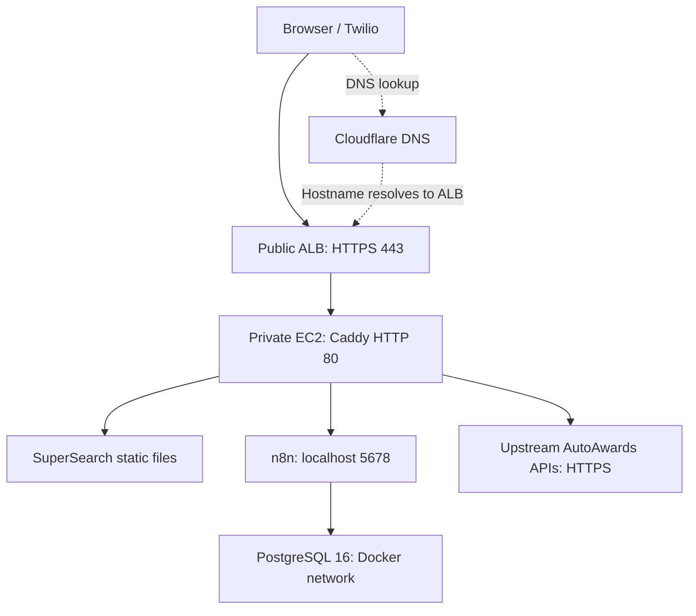
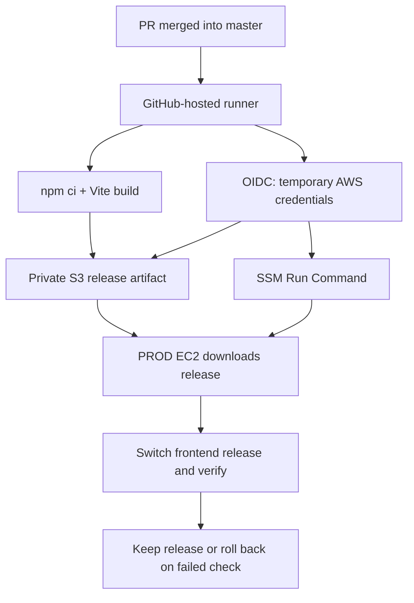

# AutoAwards SuperSearch / n8n Production Runbook

Provisioning, migration, CI/CD, credentials, monitoring, backups, and troubleshooting

Prepared: October 26, 2026. Implementation covered: October 21–23, 2026. Displayed AWS console times are America/New_York unless explicitly marked UTC.

## Contents

1. [Scope and evidence](#1-scope-evidence-and-how-to-use-this-document)
2. [Goal, plan, and decisions](#2-goal-plan-and-implementation-decisions)
3. [Architecture and resource inventory](#3-architecture-and-resource-inventory)
4. [DEV discovery](#4-discovering-the-correct-dev-application)
5. [PROD networking and permissions](#5-selecting-prod-networking-and-permissions)
6. [AMI capture and cross-account transfer](#6-consistent-ami-creation-and-encrypted-cross-account-transfer)
7. [Safe PROD clone startup](#7-booting-the-prod-clone-without-duplicate-sms-processing)
8. [n8n and PostgreSQL configuration](#8-production-application-configuration-and-safe-n8n-startup)
9. [Caddy, ALB, ACM, and DNS](#9-caddy-routing-alb-certificate-and-dns)
10. [SMS cutover and restart policies](#10-sms-cutover-and-automatic-startup)
11. [Monitoring, Slack alerts, and backups](#11-monitoring-notification-routing-and-backups)
12. [Repository, S3, and IAM](#12-cicd-prerequisites-repository-s3-and-iam)
13. [Server deployment prerequisites](#13-preparing-the-server-for-frontend-deployments)
14. [Complete workflow YAML](#14-complete-single-file-github-actions-workflow)
15. [Environment files and API credentials](#15-environment-files-and-production-api-credentials)
16. [Complete sanitized Caddyfile](#16-sanitized-caddyfile-reference)
17. [Node and dependency follow-ups](#17-node-version-linting-and-dependency-warnings)
18. [OIDC troubleshooting](#18-oidc-troubleshooting-history-and-commands)
19. [Operations and recovery commands](#19-routine-operations-and-recovery-reference)
20. [Cleanup and cost decisions](#20-cleanup-and-cost-control-decisions)
21. [Follow-ups and ticket summary](#21-follow-up-checklist-and-ticket-ready-summary)
22. [Official references](#22-official-references)

## 1. Scope, evidence, and how to use this document

This document records the plan and steps followed to provision the AutoAwards production server and automate SuperSearch deployment. It is reconstructed from the commands, configuration, screenshots, and results shared in the implementation conversation. It is not a fresh inspection of AWS or GitHub.

**No real passwords, private keys, or authentication tokens are included.** Placeholders must never be deployed as actual credentials.

Command locations are explicit:

- **Mac / DEV AWS credentials:** AWS CLI calls against account `534725115372`.
- **Mac / PROD AWS credentials:** AWS CLI calls against account `451781105151`.
- **DEV SSM:** shell on `dev-automations`, hostname `ip-10-33-54-189`.
- **PROD SSM:** shell on `prod-automations`, hostname `ip-10-101-134-201`.
- **Mac / repository:** local checkout of `BetterCarPeople/AA-supersearch`.

Commands are a reference, not one script to execute from top to bottom. Provisioning, stopping containers, changing credentials, deployment, and deletion commands modify resources. Do not repeat completed migration steps on a live service.

### Confirmed results and follow-up items

| Item | Evidence / status from the conversation |
|---|---|
| Production EC2 provisioned | Confirmed; instance `i-03ef45fce2e4edaa9` |
| Production-owned AMI copy | Confirmed; `ami-08054c20e73939479` |
| Private access through SSM | Confirmed; correct EC2 role identity verified |
| Caddy, n8n, PostgreSQL | Started successfully; HTTP health checks passed |
| Public DNS, certificate, ALB | Public HTTPS returned 200; target healthy |
| SMS cutover | User reported John published PROD workflows, updated/tested Twilio, then DEV n8n was stopped |
| Container restart settings | Both `unless-stopped`; Docker and Caddy enabled |
| CloudWatch agent | Running; disk and memory values displayed |
| Five alarms | User confirmed all OK; Slack test received |
| Backups | Two completed recovery points verified, with 35-day and 31-day retention |
| GitHub deployment | User reported a successful deployment after fixing OIDC trust |
| Missing frontend variables | Browser showed `/undefined`; workflow fix was subsequently committed and merged |
| Final searches after environment fix | Explicit successful functional result was not supplied; verify before treating this issue as closed |
| Server environment credentials | File created/updated; Caddy validation and restart passed; page returned 200 |
| Node 24.18.0 / package-driven Node selection | Discussed and verified as available; not confirmed committed or deployed |
| Dependency vulnerabilities | npm reported 2 high and 1 critical; remediation not confirmed |
| Restore / reboot recovery testing | Not performed in the recorded steps |
| Temporary AMI deletion | Cleanup discussed; deletion not confirmed |
| DEV and PROD on one instance | Discussed only; not implemented |

## 2. Goal, plan, and implementation decisions

The request was to create a production instance of the existing AutoAwards SuperSearch/SMS service, provide more resources than DEV, configure the new domain, test SuperSearch/SMS, and update Twilio webhooks.

The implementation plan was:

1. Identify the actual DEV host and application layout.
2. Inspect its containers, data, image versions, disk encryption, and restart behavior.
3. Confirm the destination AWS account and select production networking.
4. Create dedicated instance permissions and security groups.
5. Capture a consistent image with the application/database stopped briefly.
6. Re-encrypt and share the image across accounts, then create a PROD-owned copy.
7. Boot PROD with outbound traffic blocked and Docker disabled until cloned workflows were controlled.
8. Configure production URLs, start the database, unpublish copied workflows, and verify the application.
9. Configure Caddy, an ALB, ACM, and DNS.
10. Coordinate SMS cutover and stop DEV n8n after production testing.
11. Verify restarts, monitoring, alarms, Slack notification routing, and backup coverage.
12. Implement GitHub Actions deployment from `master` using OIDC, S3, and SSM.
13. Separate frontend build settings from production proxy credentials.

### Decisions and their reasons

| Decision | Reason |
|---|---|
| Reuse `PDSProduction-vpc` | User agreed to existing production networking; no new VPC/NAT/VPN build required |
| Dedicated security groups | Control this service's traffic without changing unrelated applications |
| Private EC2 instance | Public requests enter through the ALB; management through SSM |
| Clone existing DEV installation | John requested a clone including the n8n SMS setup |
| Customer-managed DEV transfer key | DEV's AWS-managed EBS key could not be shared across accounts |
| PROD-owned encrypted copy | Production does not depend on the DEV transfer key for this copy |
| Initially block automatic SMS startup | Copied schedules/credentials could otherwise process alongside DEV |
| Caddy remains installed on the host | Matches existing static frontend and API proxy design |
| GitHub-hosted runner + OIDC + SSM | Same overall pattern as the FastMSP workflow supplied by the user |
| S3 instead of ECR for SuperSearch | Deploy static Vite files; no custom container image is required |
| One workflow YAML | User requested build/deployment/rollback logic in one file |
| Deploy on updates to `master` | John confirmed production branch; PR merges trigger deployment |
| Root-protected API environment file | Keeps actual credentials out of GitHub and frontend artifacts |

## 3. Architecture and resource inventory



Cloudflare's application CNAME was configured DNS-only: traffic goes to the AWS ALB rather than through Cloudflare's HTTP proxy. Caddy forwards API requests server-side and adds upstream credentials.



### AWS and server details

| Resource | Value |
|---|---|
| DEV account | `534725115372` |
| PROD account | `451781105151` |
| Region | `us-east-1` |
| Correct DEV instance | `i-0d26ad5231749e964` — `dev-automations` |
| DEV private IP / hostname | `10.33.54.189` / `ip-10-33-54-189` |
| DEV instance type | `t3.large`: 2 vCPU, 8 GiB RAM |
| DEV VPC | `vpc-046d70b40a1a91f6e` |
| DEV subnet | `subnet-0656bbf6e9f480f95` |
| DEV security group | `sg-00acd6e629279e87d` |
| DEV original source AMI | `ami-0b6c6ebed2801a5cb` |
| DEV root device / volume | `/dev/sda1` / `vol-016957e6c18cf2ca8` |
| DEV root disk | 30 GiB gp3, encrypted |
| PROD instance | `i-03ef45fce2e4edaa9` — `prod-automations` |
| PROD private IP / hostname | `10.101.134.201` / `ip-10-101-134-201` |
| PROD instance type | `t3.xlarge`: 4 vCPU, 16 GiB RAM |
| PROD storage | 30 GiB selected in the discussion; exact final provisioned size should be checked in EC2 |
| PROD public IP | None |
| PROD VPC | `vpc-08223c6506e4e3325` — `PDSProduction-vpc`, `10.101.0.0/16` |
| PROD private subnet | `subnet-00de99cff74b23f61` — us-east-1a |
| Other private subnet | `subnet-0fbf94e6615dce9ff` — us-east-1b |
| Public ALB subnet, 1a | `subnet-09836974befe93da6` |
| Public ALB subnet, 1b | `subnet-0bfea642dffe5388e` |
| EC2 security group | `sg-0a5ea9c21c32d48be` — `prod-automations-ec2-sg` |
| ALB security group | `sg-090ba1fb85a9e9378` — `prod-automations-alb-sg` |
| Instance IAM role/profile | `prod-automations-ec2-role` |
| Deploy role | `prod-supersearch-github-deploy-role` |
| Target group | `prod-automations-tg` |
| Target group ARN | `arn:aws:elasticloadbalancing:us-east-1:451781105151:targetgroup/prod-automations-tg/3ebf6b070516ccc8` |
| ALB name | `prod-automations-alb` |
| ALB DNS name | `prod-automations-alb-2007217146.us-east-1.elb.amazonaws.com` |
| Production URL | `https://automations.autoawards.com/super-search/` |
| Artifact bucket | `451781105151-prod-supersearch-artifacts` |
| Repository | `https://github.com/BetterCarPeople/AA-supersearch` |
| Production branch | `master` |
| Workflow file | `.github/workflows/deploy-production.yml` |

### Network routes observed

| Subnet(s) | Route table | Default route |
|---|---|---|
| Private us-east-1a | `rtb-066b8606a57664304` | `nat-0b257c575a8360b5c` |
| Private us-east-1b | `rtb-04e472d263e430d11` | `nat-027ae90c23ed795fe` |
| Both public subnets | `rtb-005d1f1791a3bb42f` | `igw-054a020aff7e0299c` |

Private route tables also contained VPC peering routes. A route alone does not prove VPN authorization or end-to-end connectivity; security groups, NACLs, return routes, and service availability also matter.

### Application files and storage

| File / location | Purpose |
|---|---|
| `/home/ubuntu/n8n-docker/docker-compose.yml` | n8n/PostgreSQL service definitions |
| `/etc/caddy/Caddyfile` | Host routing, static serving, API proxy |
| `/etc/caddy/api.env` | Protected, URL-encoded API credentials |
| `/etc/systemd/system/caddy.service.d/api-env.conf` | Loads the credential environment file |
| `/var/www/super-search` | Current frontend; workflow converts it into a release symlink |
| `/var/www/super-search-releases` | Versioned frontend releases and baseline |
| `n8n-docker_n8n_data` | n8n persistent state, mounted at `/home/node/.n8n` |
| `n8n-docker_postgres_data` | PostgreSQL data, mounted at `/var/lib/postgresql/data` |

Observed data sizes during migration: n8n data **16 MiB**, PostgreSQL data **69 MiB**, SuperSearch files **1.5 MiB**. DEV root filesystem usage was about **11 GiB of 29 GiB usable**. These were point-in-time measurements, not peak production requirements.

## 4. Discovering the correct DEV application

Several candidate instances were considered. `automations-dev` (`i-001697755d4aab899`) had no application listener and only an old `hello-world` container. Another candidate was stopped. The verified application host was `i-0d26ad5231749e964`.

### DEV SSM: inspect services and listeners

```bash
hostname
sudo systemctl status caddy --no-pager
sudo ls -la /etc/caddy
sudo ss -lntp
sudo docker ps --format 'table {{.Names}}\t{{.Image}}\t{{.Ports}}'
sudo docker ps -a
sudo systemctl list-units --type=service --state=running --no-pager
free -h
df -h /
```

These identify the host, service manager, listeners, containers, RAM, and filesystem space. Use `/etc/caddy/Caddyfile`, not `etc/caddy` or `/etc/caddy.Caddyfile`. Use `df -h /` with a space.

The verified DEV host had Caddy on HTTP 80, n8n published only on `127.0.0.1:5678`, and PostgreSQL accessible through Docker networking. Port 2019 was Caddy's loopback admin endpoint.

To inspect Caddy locally:

```bash
sudo less /etc/caddy/Caddyfile
```

Press `q` to exit. Do not paste the full configuration if it contains credentials.

### Mac: trace DNS to the backend

```bash
dig dev-automations.autoawards.com
dig automations.autoawards.com
dig +short NS autoawards.com
```

DEV resolved through `dev-lb-472284765.us-east-1.elb.amazonaws.com`. Production initially returned NXDOMAIN. Authoritative nameservers were `margaret.ns.cloudflare.com` and `alan.ns.cloudflare.com`, establishing that public DNS was managed in Cloudflare, even though the application runs in AWS.

Console tracing: **EC2 → Load Balancers → dev-lb → Listeners and rules → matching host rule → target group → registered targets**.

### DEV SSM: locate Compose, data, and versions

```bash
sudo docker inspect n8n-docker-n8n-1 \
  --format 'Directory: {{index .Config.Labels "com.docker.compose.project.working_dir"}}
Compose files: {{index .Config.Labels "com.docker.compose.project.config_files"}}'

sudo docker inspect n8n-docker-n8n-1 n8n-docker-postgres-1 \
  --format '{{.Name}}{{range .Mounts}}{{printf "\n  %s: %s -> %s" .Type .Source .Destination}}{{end}}'

sudo docker exec n8n-docker-n8n-1 n8n --version

sudo docker inspect n8n-docker-n8n-1 n8n-docker-postgres-1 \
  --format '{{.Name}} restart={{.HostConfig.RestartPolicy.Name}}'

sudo docker stats --no-stream
sudo ls -lah /home/ubuntu/n8n-docker

sudo du -sh \
  /var/lib/docker/volumes/n8n-docker_n8n_data/_data \
  /var/lib/docker/volumes/n8n-docker_postgres_data/_data \
  /var/www/super-search

sudo docker inspect n8n-docker-n8n-1 n8n-docker-postgres-1 \
  --format '{{.Name}} image={{.Config.Image}} image_id={{.Image}}'
```

n8n was version **2.12.2** and PostgreSQL was **16**. Images were unpinned (`docker.n8n.io/n8nio/n8n`, `postgres:16`). We preserved local images in the AMI and used `--pull never` during setup rather than unintentionally upgrading.

Registry digests can be inspected separately from local image IDs:

```bash
sudo docker image inspect \
  "$(sudo docker inspect --format '{{.Image}}' n8n-docker-n8n-1)" \
  "$(sudo docker inspect --format '{{.Image}}' n8n-docker-postgres-1)" \
  --format '{{json .RepoTags}} {{json .RepoDigests}}'
```

The registry-digest command was proposed; its results were not supplied. Do not treat a local image ID as an interchangeable registry pull digest.

## 5. Selecting PROD networking and permissions

### Mac / PROD credentials: inventory commands

Always establish which account your CLI uses before an account-specific action:

```bash
aws sts get-caller-identity

aws ec2 describe-vpcs --region us-east-1 \
  --query 'Vpcs[].{Name:Tags[?Key==`Name`]|[0].Value,VPC:VpcId,CIDR:CidrBlock}' \
  --output table

aws elbv2 describe-load-balancers --region us-east-1 \
  --query 'LoadBalancers[].{Name:LoadBalancerName,VPC:VpcId,Type:Type}' \
  --output table

aws ec2 describe-instances --region us-east-1 \
  --filters Name=instance-state-name,Values=running,stopped \
  --query 'Reservations[].Instances[].{Name:Tags[?Key==`Name`]|[0].Value,ID:InstanceId,VPC:VpcId,Subnet:SubnetId}' \
  --output table

aws ec2 describe-subnets --region us-east-1 \
  --filters Name=vpc-id,Values=vpc-08223c6506e4e3325 \
  --query 'Subnets[].{Name:Tags[?Key==`Name`]|[0].Value,Subnet:SubnetId,AZ:AvailabilityZone,CIDR:CidrBlock,FreeIPs:AvailableIpAddressCount,PublicIP:MapPublicIpOnLaunch}' \
  --output table

aws ec2 describe-route-tables --region us-east-1 \
  --filters Name=vpc-id,Values=vpc-08223c6506e4e3325 \
  --query 'RouteTables[].{ID:RouteTableId,Associations:Associations[].{Subnet:SubnetId,Main:Main},Routes:Routes}' \
  --output json
```

These are read-only. Subnet names and `MapPublicIpOnLaunch` alone do not prove a public/private routing design. We inspected actual route tables before choosing the subnet.

### EC2 IAM role

We inspected existing profiles:

```bash
aws iam list-instance-profiles \
  --query 'InstanceProfiles[].{Profile:InstanceProfileName,Roles:Roles[].RoleName}' \
  --output json

aws iam list-attached-role-policies \
  --role-name SSMEC2Role --output table
```

`SSMEC2Role` already supported SSM but included unrelated S3/secret/KMS access. The user chose a narrower new role.

Console: **IAM → Roles → Create role → AWS service → EC2**. Created `prod-automations-ec2-role` with:

- `AmazonSSMManagedInstanceCore`.
- `CloudWatchAgentServerPolicy`.
- Later, a repository-specific S3 artifact read policy (section 12).

SSM access needs the agent, instance permissions, and outbound connectivity or appropriate VPC endpoints. No inbound SSH key was needed for this setup.

### Security group configuration

| Group | Direction | Rule |
|---|---|---|
| `prod-automations-ec2-sg` | Inbound | HTTP TCP 80 from `sg-090ba1fb85a9e9378` only |
| `prod-automations-ec2-sg` | Outbound, initial isolated boot | No outbound rules |
| `prod-automations-ec2-sg` | Outbound, after Docker-disable confirmation | HTTPS TCP 443 to `0.0.0.0/0` |
| `prod-automations-alb-sg` | Inbound | HTTP TCP 80 and HTTPS TCP 443 from `0.0.0.0/0` |
| `prod-automations-alb-sg` | Outbound | HTTP TCP 80 to `sg-0a5ea9c21c32d48be` |

The outbound rules above describe the configuration instructed during the session; recheck current rules before relying on them. There was no need to expose n8n port 5678 or PostgreSQL port 5432 publicly.

## 6. Consistent AMI creation and encrypted cross-account transfer

### Mac / DEV credentials: inspect original disk and keys

```bash
aws ec2 describe-instances --region us-east-1 \
  --instance-ids i-0d26ad5231749e964 \
  --query 'Reservations[].Instances[].{AMI:ImageId,Architecture:Architecture,RootDevice:RootDeviceName,Disks:BlockDeviceMappings[].Ebs.VolumeId}' \
  --output json

aws ec2 describe-volumes --region us-east-1 \
  --volume-ids vol-016957e6c18cf2ca8 \
  --query 'Volumes[].{Volume:VolumeId,SizeGiB:Size,Type:VolumeType,Encrypted:Encrypted,KMSKey:KmsKeyId}' \
  --output table

aws kms describe-key --region us-east-1 \
  --key-id 5eb0992e-3242-47c4-a4ea-f915aaabc11f \
  --query 'KeyMetadata.{Manager:KeyManager,State:KeyState,Description:Description}' \
  --output table
```

Original encryption used AWS-managed key `5eb0992e-3242-47c4-a4ea-f915aaabc11f`. We could not share that key cross-account.

An existing suitable customer-managed key was available:

- Alias: `key-for-sharing-with-production-kms`.
- ARN: `arn:aws:kms:us-east-1:534725115372:key/34cae4fe-5485-4d8e-ac65-d6afca4c0cfb`.

```bash
aws kms describe-key --region us-east-1 \
  --key-id 34cae4fe-5485-4d8e-ac65-d6afca4c0cfb \
  --query 'KeyMetadata.{ARN:Arn,Manager:KeyManager,State:KeyState,Usage:KeyUsage}' \
  --output table

aws kms get-key-policy --region us-east-1 \
  --key-id 34cae4fe-5485-4d8e-ac65-d6afca4c0cfb \
  --policy-name default --query Policy --output text
```

The observed policy allowed PROD account `451781105151` to encrypt/decrypt, re-encrypt, generate data keys, describe the key, and create/list/revoke service-related grants. Account-level trust also requires the destination caller to have corresponding IAM permissions. We reused this key rather than creating another one.

### DEV SSM: coordinated maintenance window

Do this only for a coordinated image capture, not for routine frontend deployment. Finish/check active n8n executions first. A stop timeout does not guarantee all long executions complete.

```bash
sudo docker compose -f /home/ubuntu/n8n-docker/docker-compose.yml \
  stop -t 120 n8n

sudo docker compose -f /home/ubuntu/n8n-docker/docker-compose.yml \
  stop -t 60 postgres

sudo docker compose -f /home/ubuntu/n8n-docker/docker-compose.yml ps -a
```

Both containers reported `Exited (0)`. Explicit `-f` was needed because the SSM user could not `cd` into `/home/ubuntu/n8n-docker`.

**Never use `docker compose down -v` for this process: it deletes named volumes.**

### DEV console: create and copy the image

1. EC2 → Instances → select `i-0d26ad5231749e964`.
2. Actions → Image and templates → Create image.
3. Name: `dev-automations-prod-clone-20261021`.
4. Select **No reboot** because application and database were deliberately stopped cleanly.
5. Preserve disk mappings and create the image.
6. In this implementation, we waited until the AMI was **Available** before restarting DEV.

The initial 5–10 minute downtime estimate was not a guarantee; snapshot completion can take longer. Copy/re-encryption and cross-account transfer happen after DEV is restarted and do not require continued application downtime.

### DEV SSM: restore DEV service

```bash
sudo docker compose -f /home/ubuntu/n8n-docker/docker-compose.yml start postgres
sudo docker exec n8n-docker-postgres-1 pg_isready -U n8nuser -d n8ndb
```

After `accepting connections`:

```bash
sudo docker compose -f /home/ubuntu/n8n-docker/docker-compose.yml start n8n
sudo docker compose -f /home/ubuntu/n8n-docker/docker-compose.yml ps
```

Then verify DEV application functionality.

### Re-encrypt, share, and copy into PROD

1. In DEV EC2 → AMIs, copy the original clone in the same region.
2. Name: `autoawards-prod-transfer-20261021`.
3. Encrypt using `key-for-sharing-with-production-kms`.
4. Wait for **Available**. Transfer AMI: `ami-0ea233121c29a7215`.
5. Edit AMI permissions, keep Private, and share with `451781105151`.
6. Explicitly share the backing snapshot for copying.
7. In PROD EC2 → AMIs → Private images, copy the shared image into a PROD-owned image, name `prod-automations-base-20261021`, using PROD `alias/aws/ebs` or an appropriate PROD-owned key.
8. Wait for Available. Final AMI: `ami-08054c20e73939479`.

### Troubleshooting: AMI visible but storage access denied

The initial PROD copy failed with **You do not have permission to access the storage of this ami**. Inspection found the correct sharing key was in use, but explicit snapshot access was missing.

DEV-side read-only checks:

```bash
aws ec2 describe-images --region us-east-1 \
  --image-ids ami-0ea233121c29a7215 \
  --query 'Images[].{Owner:OwnerId,State:State,Snapshots:BlockDeviceMappings[].Ebs.SnapshotId}' \
  --output json

aws ec2 describe-snapshots --region us-east-1 \
  --snapshot-ids snap-04430e768989b151a \
  --query 'Snapshots[].{State:State,Encrypted:Encrypted,KMSKey:KmsKeyId}' \
  --output table
```

The backing snapshot was `snap-04430e768989b151a`, completed and encrypted with the customer-managed sharing key.

DEV-side permission change that resolved the copy failure:

```bash
aws ec2 modify-snapshot-attribute --region us-east-1 \
  --snapshot-id snap-04430e768989b151a \
  --attribute createVolumePermission \
  --operation-type add \
  --user-ids 451781105151
```

This grants access to the specified account; it does not make the snapshot public. The subsequent PROD copy succeeded.

## 7. Booting the PROD clone without duplicate SMS processing

Launch configuration: final PROD AMI, `t3.xlarge`, private subnet in us-east-1a, no public IP, dedicated EC2 security group, `prod-automations-ec2-role`, and no new SSH key pair. The cloned disk still contained a prior DEV authorized SSH key; choosing no key pair does not remove keys already on disk. Review/remove that inherited key through the team's access process.

Console sequence: **EC2 → AMIs → Owned by me → `ami-08054c20e73939479` → Launch instance from AMI**. Set name `prod-automations`; choose the instance type, private subnet, and existing dedicated security group; disable public-IP assignment. Select the instance profile under **Advanced details → IAM instance profile**, and paste the user data below before launching. If a newly created role is absent from that list, check that it has an EC2 instance profile and that the launching identity can pass it to EC2.

The source root disk was 30 GiB gp3; 50 GiB was discussed but is not required simply to make a clone. A copied AMI's root disk cannot be reduced below its snapshot requirement at launch. No separate EFS/file-system attachment was needed for this design: the application files and Docker named volumes were on the imaged EBS disk. The observed 16 GiB usable server memory confirmed the larger instance; the final EBS size was not pasted and remains an inventory check.

Before launch, the EC2 security group had no outbound rules. This was the initial protection against external automation before user data could run.

User data used:

```bash
#!/bin/bash
set -eu
systemctl stop docker.service docker.socket
systemctl mask docker.service docker.socket
if systemctl is-active --quiet docker.service; then
  exit 1
fi
echo "AUTOMATIONS_DOCKER_DISABLED" > /dev/console
```

This stops the Docker engine and socket and prevents ordinary service startup until explicitly unmasked. User data alone can run after other boot services, which is why initial outbound blocking was also used.

Check EC2 → Actions → Monitor and troubleshoot → Get system log, or from Mac / PROD:

```bash
aws ec2 get-console-output --region us-east-1 \
  --instance-id i-03ef45fce2e4edaa9 \
  --latest --query Output --output text
```

The first log capture ended early in boot. The later log confirmed the Docker service/socket masks, `AUTOMATIONS_DOCKER_DISABLED`, and cloud-init completion. Only then was outbound HTTPS restored for SSM.

### PROD SSM: verify startup controls

```bash
hostname
sudo systemctl is-enabled docker.service docker.socket
sudo systemctl is-active docker.service docker.socket
```

Expected/observed: correct PROD hostname, `masked`, and `inactive` for both units.

### Inspect saved container state while Docker is stopped

```bash
sudo python3 - <<'PY'
import glob, json, os
for path in glob.glob('/var/lib/docker/containers/*/config.v2.json'):
    with open(path) as f:
        config = json.load(f)
    with open(os.path.join(os.path.dirname(path), 'hostconfig.json')) as f:
        host = json.load(f)
    print(
        config.get('Name'),
        'restart=', host.get('RestartPolicy'),
        'manually_stopped=', config.get('HasBeenManuallyStopped'),
        'running=', config.get('State', {}).get('Running')
    )
PY
```

Both n8n and PostgreSQL had `manually_stopped=True`, `running=False`, restart policy `unless-stopped`. This supported starting Docker without automatically starting those manually stopped containers.

```bash
sudo systemctl unmask docker.service docker.socket
sudo systemctl start docker.service
sudo docker ps

sudo docker update --restart=no \
  n8n-docker-n8n-1 n8n-docker-postgres-1
```

`docker ps` showed only headers. The temporary restart settings kept setup under manual control. Changing Compose YAML alone does not update existing containers' runtime restart policies.

## 8. Production application configuration and safe n8n startup

Backups made on PROD:

```bash
sudo cp /home/ubuntu/n8n-docker/docker-compose.yml \
  /home/ubuntu/n8n-docker/docker-compose.yml.pre-prod
sudo cp /etc/caddy/Caddyfile /etc/caddy/Caddyfile.pre-prod
```

Existing config backups may contain secrets. Keep them out of Git/artifacts and restrict their permissions; the private `/root` backup pattern in section 15 is preferable for future Caddy backups.

Production n8n URLs were changed to:

```yaml
- N8N_HOST=automations.autoawards.com
- WEBHOOK_URL=https://automations.autoawards.com/
```

`N8N_PROTOCOL=http` remained the internal setup from DEV. `N8N_EDITOR_BASE_URL` and `N8N_PROXY_HOPS` were discussed but their addition was not confirmed. Do not assume a proxy hop count without checking the ALB → Caddy → n8n forwarding behavior.

### Sanitized Compose reference

This example reflects the relevant service layout and final restart policy; it is not a byte-for-byte export of the final server file. Preserve the actual n8n encryption key to decrypt copied credentials. Resolve placeholders securely before use; the frontend workflow does not deploy this file.

```yaml
services:
  postgres:
    image: postgres:16
    restart: unless-stopped
    environment:
      POSTGRES_USER: n8nuser
      POSTGRES_PASSWORD: ${POSTGRES_PASSWORD:?Supply securely}
      POSTGRES_DB: n8ndb
    volumes:
      - postgres_data:/var/lib/postgresql/data

  n8n:
    image: docker.n8n.io/n8nio/n8n
    restart: unless-stopped
    ports:
      - "127.0.0.1:5678:5678"
    depends_on:
      - postgres
    environment:
      N8N_HOST: automations.autoawards.com
      N8N_PORT: 5678
      N8N_PROTOCOL: http
      WEBHOOK_URL: https://automations.autoawards.com/
      GENERIC_TIMEZONE: America/Chicago
      TZ: America/Chicago
      DB_TYPE: postgresdb
      DB_POSTGRESDB_HOST: postgres
      DB_POSTGRESDB_PORT: 5432
      DB_POSTGRESDB_DATABASE: n8ndb
      DB_POSTGRESDB_USER: n8nuser
      DB_POSTGRESDB_PASSWORD: ${POSTGRES_PASSWORD:?Supply securely}
      N8N_ENCRYPTION_KEY: ${N8N_ENCRYPTION_KEY:?Preserve the existing key}
    volumes:
      - n8n_data:/home/node/.n8n

volumes:
  postgres_data:
  n8n_data:
```

DEV also contained legacy `N8N_BASIC_AUTH_*` entries and a templates setting. They are omitted here rather than claiming those legacy entries establish effective n8n 2.x authentication. A future image pinning/hardening change should be separately reviewed.

### Validate Compose without printing secrets

```bash
sudo docker compose \
  -f /home/ubuntu/n8n-docker/docker-compose.yml config --quiet
```

No output means schema validation passed. A mistaken top-level key `automations.autoawards.comservices` was corrected to `services:` before continuing.

### Start only PostgreSQL; inspect copied workflows

```bash
sudo docker start n8n-docker-postgres-1
sudo docker exec n8n-docker-postgres-1 \
  pg_isready -U n8nuser -d n8ndb

sudo docker exec n8n-docker-postgres-1 \
  psql -U n8nuser -d n8ndb \
  -c 'SELECT id, name, active FROM workflow_entity ORDER BY name;'
```

If readiness initially reports no response, inspect state/logs and retry after startup:

```bash
sudo docker ps -a --filter name=n8n-docker-postgres-1
sudo docker logs --tail 60 n8n-docker-postgres-1
```

Observed copied workflows:

| Workflow | ID | Initially active |
|---|---|---|
| Autoawards SMS Enrollment | `UQ9P32vuRDQUD6K9` | Yes |
| Daily Sender Account Update | `cINBFgMBoYhAgGeW` | Yes |
| Test for mobile api call | `w3QXcuf8AROasLdm` | No |
| Twilio Listeners | `xoRNIS91xGoTmXs1` | Yes |

### Important correction: use n8n's supported unpublish command

An initial SQL update set `active=false` but did not clear the published version state. Startup logs later showed the three workflows activating. That approach was insufficient for this version and must not be reused as the deactivation procedure.

We stopped PROD n8n, inspected the schema, and used the supported CLI:

```bash
sudo docker stop -t 120 n8n-docker-n8n-1

sudo docker exec n8n-docker-postgres-1 \
  psql -U n8nuser -d n8ndb -c '\d workflow_entity'

sudo docker compose \
  -f /home/ubuntu/n8n-docker/docker-compose.yml \
  run --rm --no-deps --pull never n8n unpublish:workflow --all

sudo docker exec n8n-docker-postgres-1 \
  psql -U n8nuser -d n8ndb \
  -c 'SELECT name, active, "activeVersionId"
      FROM workflow_entity ORDER BY name;'
```

All four showed `active=false` with empty `activeVersionId`. The temporary CLI container did not launch the main n8n web service. **This unpublish command was a one-time migration control: do not rerun it now that PROD is live unless intentionally disabling all workflows.**

We also inspected execution statuses:

```bash
sudo docker exec n8n-docker-postgres-1 \
  psql -U n8nuser -d n8ndb \
  -c 'SELECT status, COUNT(*) AS executions
      FROM execution_entity GROUP BY status ORDER BY status;'
```

At that time: 48 successes, 1 error, no waiting/unfinished statuses reported. This was before later production activity.

### Start / recreate n8n and verify

When applying changed Compose URLs, the container was recreated using the local image:

```bash
sudo docker compose \
  -f /home/ubuntu/n8n-docker/docker-compose.yml \
  up -d --no-deps --pull never n8n
```

After the later unpublish operation we used the existing configured container:

```bash
sudo docker start n8n-docker-n8n-1
sudo docker logs --since 2m --timestamps n8n-docker-n8n-1
curl --max-time 10 -sS -o /dev/null -w 'HTTP %{http_code}\n' \
  http://127.0.0.1:5678/healthz
```

The first startup took time: initial empty logs and connection resets did not prove a crash. Inspection showed a running Node process, no OOM, no restarts, then `n8n ready` and HTTP 200.

Additional diagnostic commands used:

```bash
sudo docker inspect n8n-docker-n8n-1 \
  --format 'Status={{.State.Status}} Running={{.State.Running}} Restarting={{.State.Restarting}} ExitCode={{.State.ExitCode}} OOMKilled={{.State.OOMKilled}} Restarts={{.RestartCount}} Error={{.State.Error}}'
sudo docker top n8n-docker-n8n-1
sudo docker stats --no-stream
sudo docker logs --since 10m --timestamps n8n-docker-n8n-1
```

The missing Python task-runner warning did not prevent the JS runner/web service from starting. Workflows that actually need Python require developer review; absence of a web health error does not prove those nodes work.

## 9. Caddy routing, ALB, certificate, and DNS

### Initial Caddy change

Changed only the site hostname from `http://dev-automations.autoawards.com` to `http://automations.autoawards.com`. HTTPS termination was placed at the ALB; Caddy continues internal HTTP 80.

```bash
sudo nano /etc/caddy/Caddyfile
sudo caddy validate --config /etc/caddy/Caddyfile
sudo systemctl reload caddy
```

At this stage credentials were still hardcoded. After environment references are introduced, use the environment-aware validation in section 15 instead. A standalone validate without loading required values is not an adequate check.

Local host-specific routing tests:

```bash
curl --max-time 10 -sS -o /dev/null -w 'SuperSearch: HTTP %{http_code}\n' \
  -H 'Host: automations.autoawards.com' \
  http://127.0.0.1/super-search/

curl --max-time 10 -sS -o /dev/null -w 'n8n: HTTP %{http_code}\n' \
  -H 'Host: automations.autoawards.com' \
  http://127.0.0.1/healthz
```

Both returned 200. The HTTP-only Caddy warning is expected with ALB termination.

### ACM certificate

PROD / us-east-1 → ACM → Request public certificate:

- Domain: `automations.autoawards.com`.
- DNS validation; RSA 2048.
- Non-exportable public certificate; the certificate is free for the integrated ALB use case. ALB and other infrastructure have separate charges.

An ALB certificate must be usable in its account/region. Another account's existing ACM-managed non-exportable certificate was not attached directly; a separate PROD certificate was requested.

Maridean manages Cloudflare and added ACM's generated CNAME with **DNS only**. Exact tokenized validation name/value were not captured in full and must be obtained from the actual ACM certificate.

```bash
# Mac: replace with the actual ACM validation record name.
dig +short CNAME '<ACM-validation-CNAME-name>'
```

The target should match ACM's complete value ending in `acm-validations.aws.`. Keep this record for renewals. It is separate from the application traffic record.

### Target group and ALB

Target group console settings:

| Setting | Value |
|---|---|
| Type | Instances |
| Name | `prod-automations-tg` |
| Target | `i-03ef45fce2e4edaa9`, port 80 |
| Protocol | HTTP, HTTP1 |
| Health check | `/healthz`, success 200 |
| VPC | Existing PDSProduction VPC |

ALB: internet-facing, IPv4, both listed public subnets, only the dedicated ALB security group. HTTP 80 redirects to HTTPS 443 preserving host/path/query. HTTPS 443 uses the issued AutoAwards ACM certificate and forwards to the target group.

ALB health checks use an IP-based Host header. During planning we identified that a hostname-only Caddy configuration might need a dedicated health route. The user subsequently reported this target healthy without providing an additional health-route change. Do not claim a catch-all health block was added; inspect the actual config if recreating this behavior.

### Test before changing production DNS

Mac:

```bash
curl --connect-to \
  automations.autoawards.com:443:prod-automations-alb-2007217146.us-east-1.elb.amazonaws.com:443 \
  --max-time 15 -sS -o /dev/null \
  -w 'SuperSearch: HTTP %{http_code}\n' \
  https://automations.autoawards.com/super-search/
```

This preserves the intended TLS/HTTP hostname while connecting to the ALB directly. It returned 200.

Application DNS added by Maridean:

| Field | Value |
|---|---|
| Type | CNAME |
| Name | `automations` |
| Target | `prod-automations-alb-2007217146.us-east-1.elb.amazonaws.com` |
| Proxy | DNS only |
| TTL | Auto |

```bash
dig +short automations.autoawards.com
curl --max-time 15 -sS -o /dev/null \
  -w 'SuperSearch: HTTP %{http_code}\n' \
  https://automations.autoawards.com/super-search/
```

Public resolution and HTTP 200 were confirmed. Do not pin the ALB's resolved IP addresses; they can change.

## 10. SMS cutover and automatic startup

John confirmed SuperSearch appeared to work, published the PROD n8n workflows, and updated Twilio webhooks. After he updated and tested the cutover, the user stopped DEV n8n.

DEV SSM:

```bash
hostname
sudo docker stop -t 120 n8n-docker-n8n-1
sudo docker ps -a --filter name=n8n-docker-n8n-1
```

Hostname confirmed `ip-10-33-54-189`; n8n exited cleanly. DEV PostgreSQL remained running; the old instance was not terminated. Caddy remains installed. Frontend files may still load on DEV, but n8n-backed DEV routes no longer work while that container is stopped.

Do not restart DEV n8n merely to roll back a frontend deployment: it contains copied/live automation credentials and could re-enable duplicate schedules. Any SMS rollback requires coordination with workflow activation and Twilio routing.

### PROD restart policy verification and correction

```bash
sudo systemctl is-enabled docker.service caddy.service

sudo docker inspect \
  --format '{{.Name}} restart={{.HostConfig.RestartPolicy.Name}}' \
  n8n-docker-n8n-1 n8n-docker-postgres-1

sudo awk '/^[[:space:]]*restart:/ {print NR ": " $0}' \
  /home/ubuntu/n8n-docker/docker-compose.yml
```

Docker/Caddy were enabled; Compose used `unless-stopped`. n8n's runtime policy was already `unless-stopped`, but PostgreSQL still had `no` from setup. Fixed without restarting the database:

```bash
sudo docker update --restart=unless-stopped n8n-docker-postgres-1

sudo docker inspect \
  --format '{{.Name}} restart={{.HostConfig.RestartPolicy.Name}}' \
  n8n-docker-n8n-1 n8n-docker-postgres-1
```

Both then reported `unless-stopped`. These policies handle process/container exits and startup; they do not make an unhealthy but running application automatically healthy. Full reboot recovery and database-start ordering were not tested during the session.

## 11. Monitoring, notification routing, and backups

### CloudWatch agent

PROD SSM:

```bash
sudo systemctl status amazon-cloudwatch-agent --no-pager
sudo tail -n 80 \
  /opt/aws/amazon-cloudwatch-agent/logs/amazon-cloudwatch-agent.log
```

Agent was active/enabled. Startup logged `Ignoring unrecognized input ebs`; this unsupported configuration item was observed, not remediated. Some initial startup attempts occurred while egress was blocked, so distinguish old errors from current delivery.

Console: PROD → us-east-1 → CloudWatch → Metrics → CWAgent → filter `i-03ef45fce2e4edaa9`.

- `disk_used_percent` for `path=/`, in the disk dimension set.
- `mem_used_percent`, in the host dimension set.
- Observed screenshot values: root disk **36%**, memory **5.15%**.
- Set gauge minimum/maximum to 0/100; missing gauge range is a display setting, not proof of failed metric ingestion.

### Alarm configuration created

Notification action for each: **In alarm → SNS `PDS-system-alerts`**. No automated EC2 restart/recovery, Lambda, or scaling actions were configured. Missing data was set to **missing**.

| Alarm | Metric | Statistic | Period | Threshold | Datapoints |
|---|---|---|---|---|---|
| `prod-automations-cpu-high` | AWS/EC2 `CPUUtilization` | Average | 5 min | >80% | 3 of 3 |
| `prod-automations-root-disk-high` | CWAgent `disk_used_percent`, `/` | Average | 5 min | >80% | 3 of 3 |
| `prod-automations-memory-high` | CWAgent `mem_used_percent` | Average | 5 min | >85% | 3 of 3 |
| `prod-automations-status-check-failed` | AWS/EC2 `StatusCheckFailed` | Maximum | 1 min | >=1 | 2 of 2 |
| `prod-automations-unhealthy-target` | AWS/ApplicationELB `UnHealthyHostCount` for this ALB/TG | Maximum | 1 min | >=1 | 2 of 2 |

CPU/memory/disk thresholds are initial operational choices. They are not capacity tests. The ALB alarm detects failing health checks, but not every API/business failure; a page returning 200 is not a functional test. Missing-data behavior is also not a substitute for a separate missing-agent/telemetry alert.

Console creation: **CloudWatch → Alarms → Create alarm → Select metric → correct resource/dimensions → conditions → notification topic → name → review/create**.

The earlier name-only alarm query returned none:

```bash
aws cloudwatch describe-alarms --region us-east-1 \
  --query 'MetricAlarms[?contains(AlarmName, `automations`) || contains(AlarmName, `i-03ef45fce2e4edaa9`)].{Name:AlarmName,State:StateValue,Metric:MetricName,Actions:AlarmActions}' \
  --output json
```

A name search alone cannot exclude existing alarms with different names. The user also inspected metrics through the console. All five new alarms were eventually reported OK.

### Slack notification path

- Topic ARN: `arn:aws:sns:us-east-1:451781105151:PDS-system-alerts`.
- One confirmed HTTPS subscription pointed to `global.sns-api.chatbot.amazonaws.com`.
- Console: **Amazon Q Developer in chat applications** (formerly AWS Chatbot) → configured Slack workspace → `alerts-system`.
- Verify the attached SNS topic is the one above.
- A test message was received in the intended Slack channel.

This confirms the chat integration path. It is not equivalent to an actual alarm-transition delivery test, which was not recorded. No manual notification was sent by the assistant.

### Verify backup coverage by exact instance ARN

Mac / PROD credentials:

```bash
aws backup list-recovery-points-by-resource \
  --region us-east-1 \
  --resource-arn arn:aws:ec2:us-east-1:451781105151:instance/i-03ef45fce2e4edaa9 \
  --query 'RecoveryPoints[].{Vault:BackupVaultName,RecoveryPoint:RecoveryPointArn,Created:CreationDate,Status:Status}' \
  --output table
```

Verified recovery points from October 22:

| Vault | Recovery point | Created | Status | Retention |
|---|---|---|---|---|
| `Daily` | `arn:aws:ec2:us-east-1::image/ami-099d14878cb10ca7d` | 02:00 EDT | COMPLETED | 35 days |
| `Daily-OrgBackups` | `arn:aws:ec2:us-east-1::image/ami-08723c3c82a3b8a74` | 00:30 EDT | COMPLETED | 31 days |

```bash
aws backup describe-recovery-point \
  --region us-east-1 \
  --backup-vault-name Daily \
  --recovery-point-arn arn:aws:ec2:us-east-1::image/ami-099d14878cb10ca7d \
  --query '{Resource:ResourceArn,Status:Status,Lifecycle:Lifecycle,CalculatedLifecycle:CalculatedLifecycle,CreatedBy:CreatedBy}' \
  --output json

aws backup describe-recovery-point \
  --region us-east-1 \
  --backup-vault-name Daily-OrgBackups \
  --recovery-point-arn arn:aws:ec2:us-east-1::image/ami-08723c3c82a3b8a74 \
  --query '{Status:Status,Lifecycle:Lifecycle,CalculatedLifecycle:CalculatedLifecycle}' \
  --output json
```

Daily plan ID observed: `03076d52-9957-404f-a75c-94ff533a7345`; rule `ebc02754-e559-4593-8f1e-339853d74572`. Expirations returned were November 26 at 01:00 EST and November 21 at 23:30 EST respectively. Time display shifted across daylight-saving time.

No additional plan was created because existing plans already covered the instance. These recovery points predated the later cutover/configuration updates. Completed EC2 image backups do not by themselves establish PostgreSQL application-consistent recovery or a successful restore. Verify fresh backups and perform an isolated restore test; never boot a restored SMS clone with unrestricted automation access.

## 12. CI/CD prerequisites: repository, S3, and IAM

### Repository and branch investigation

The repository is a Vue/Vite static application. The user's FastMSP workflow already used GitHub-hosted `ubuntu-latest`, OIDC, and SSM. SuperSearch follows the same coordination approach; only the artifact differs:

| FastMSP | SuperSearch |
|---|---|
| Docker API/migration images | `dist/` static files |
| ECR | S3 archive |
| SSM launches Compose commands | SSM installs/switches frontend release |

Mac / repository checks:

```bash
git fetch origin
git branch -a
cat package.json
cat vite.config.js
cat README.md
git ls-files public
cat index.html
git --no-pager diff origin/master origin/dev -- package.json vite.config.js README.md
git grep -n -E 'fetch\(|axios|https?://|import\.meta\.env|BASE_URL' \
  -- src public index.html
```

Press `q` if Git opens a pager showing `(END)`. Repeated pager output is not multiple Git changes.

Initially `master` was significantly behind `dev`, including missing `/super-search/` base configuration and frontend features. John confirmed production should deploy from `master`, then the user reported DEV changes merged into `master`. The workflow feature branch was rebased conceptually by creating a new branch from `origin/master` and then merging later master updates, rather than accidentally shipping all DEV changes as part of the workflow PR.

The Mac lacked Node/npm. Local building was discussed but not required; GitHub installs the build toolchain. No Node installation on EC2 is required to serve the resulting static files.

### Application build files inspected

The supplied `package.json` defined these scripts. `npm run build` runs Vite; it does not build a Docker image or deploy files itself.

```json
{
  "scripts": {
    "dev": "vite",
    "build": "vite build",
    "preview": "vite preview",
    "lint": "run-s \"lint:*\"",
    "lint:oxlint": "oxlint . --fix",
    "lint:eslint": "eslint . --fix --cache",
    "format": "prettier --write --experimental-cli src/"
  },
  "engines": {
    "node": "^22.18.0 || >=24.12.0"
  }
}
```

This is a relevant excerpt, not a replacement for the complete file containing dependencies. `package-lock.json` is committed and used by `npm ci` to select dependency versions.

The `dev` branch's supplied `vite.config.js` diff showed the following configuration. John subsequently merged the application changes into `master`; this is a reconstruction of the inspected diff, not a new application change made by this runbook:

```javascript
import { fileURLToPath, URL } from 'node:url'
import { defineConfig, loadEnv } from 'vite'
import vue from '@vitejs/plugin-vue'
import vueJsx from '@vitejs/plugin-vue-jsx'

export default defineConfig(({ mode, command }) => {
  const env = loadEnv(mode, process.cwd(), '')
  const apiHost = env.VITE_API_HOST
  const loginName = env.API_LOGIN_NAME
  const password = env.API_PASSWORD

  function injectCredentials(loginParam) {
    return (proxy) => {
      proxy.on('proxyReq', (proxyReq) => {
        const separator = proxyReq.path.includes('?') ? '&' : '?'
        proxyReq.path += `${separator}${loginParam}=${encodeURIComponent(loginName)}&Password=${encodeURIComponent(password)}`
      })
    }
  }

  return {
    base: command === 'build' ? '/super-search/' : '/',
    plugins: [vue(), vueJsx()],
    resolve: {
      alias: {
        '@': fileURLToPath(new URL('./src', import.meta.url)),
      },
    },
    server: {
      proxy: {
        '/mobileDBaccess': {
          target: apiHost,
          changeOrigin: true,
          configure: injectCredentials('loginName'),
        },
        '/CRMDBAccess': {
          target: apiHost,
          changeOrigin: true,
          configure: injectCredentials('Login'),
        },
      },
    },
  }
})
```

`loadEnv` reads the appropriate Vite environment files. The `server.proxy` handlers run when using the local Vite development server; they are not included as a running proxy in the static production build. Caddy supplies that role in production. The build base places assets under `/super-search/`; the workflow also explicitly supplies the same base.

The original inspected `index.html` used `/favicon.ico` and `/assets/fontawesome/...` paths, and public files existed under `public/`. Asset-path changes were among the application files merged by John, but their final contents were not pasted. The workflow PR was kept separate from those developer-owned edits. Verify generated asset URLs in the browser rather than assuming an HTML 200 proves fonts and icons work.

### Private artifact bucket

Created in PROD/us-east-1:

- Name `451781105151-prod-supersearch-artifacts`.
- General-purpose bucket, ACLs disabled.
- All Block Public Access settings enabled.
- Versioning enabled, SSE-S3 encryption.
- Artifact key layout: `supersearch/releases/<commit>-<run-id>-<attempt>/site.tar.gz`.

The account prefix is a naming choice to reduce global bucket-name collisions. It is not technically required. The bucket was kept under its original account-prefixed name.

The bucket is a transfer/release store, not a public website bucket. Versioning alone does not provide a retention policy; lifecycle/noncurrent-version cleanup was not configured in the recorded steps.

### GitHub deployment-role trust policy — final working subject

Role: `arn:aws:iam::451781105151:role/prod-supersearch-github-deploy-role`.

Existing identity provider reused: `token.actions.githubusercontent.com`, audience `sts.amazonaws.com`. No GitHub environment was ultimately required because the user lacked repository Settings access; the policy was restricted to the production branch instead.

**Use the exact observed OIDC subject, including the organization/repository IDs:**

```json
{
  "Version": "2012-10-17",
  "Statement": [
    {
      "Effect": "Allow",
      "Principal": {
        "Federated": "arn:aws:iam::451781105151:oidc-provider/token.actions.githubusercontent.com"
      },
      "Action": "sts:AssumeRoleWithWebIdentity",
      "Condition": {
        "StringEquals": {
          "token.actions.githubusercontent.com:aud": "sts.amazonaws.com",
          "token.actions.githubusercontent.com:sub": "repo:BetterCarPeople@1440728/AA-supersearch@1381737457:ref:refs/heads/master"
        }
      }
    }
  ]
}
```

The earlier plain `repo:BetterCarPeople/AA-supersearch:ref:refs/heads/master` subject failed. The repository's actual token subject included immutable identifiers. Do not generalize this exact subject to other repositories; inspect their actual claims if necessary.

### GitHub role inline permissions: `prod-supersearch-deploy`

```json
{
  "Version": "2012-10-17",
  "Statement": [
    {
      "Sid": "UploadSuperSearchReleases",
      "Effect": "Allow",
      "Action": "s3:PutObject",
      "Resource": "arn:aws:s3:::451781105151-prod-supersearch-artifacts/supersearch/releases/*"
    },
    {
      "Sid": "DeployToSuperSearchInstance",
      "Effect": "Allow",
      "Action": "ssm:SendCommand",
      "Resource": [
        "arn:aws:ssm:us-east-1::document/AWS-RunShellScript",
        "arn:aws:ec2:us-east-1:451781105151:instance/i-03ef45fce2e4edaa9"
      ]
    },
    {
      "Sid": "CheckDeploymentResult",
      "Effect": "Allow",
      "Action": "ssm:GetCommandInvocation",
      "Resource": "*"
    }
  ]
}
```

This confines S3 upload scope and the SSM target, but `AWS-RunShellScript` runs as root on that instance. Protect review/merge rights to `master`; this is not filesystem-level isolation from the server's other services/secrets. No permanent AWS access keys are stored in GitHub.

### EC2 role inline permissions: `prod-supersearch-artifact-read`

```json
{
  "Version": "2012-10-17",
  "Statement": [
    {
      "Sid": "DownloadSuperSearchReleases",
      "Effect": "Allow",
      "Action": "s3:GetObject",
      "Resource": "arn:aws:s3:::451781105151-prod-supersearch-artifacts/supersearch/releases/*"
    }
  ]
}
```

SSE-S3 artifacts do not need a separate KMS decrypt policy. Listing the bucket is unnecessary for downloading a known object key.

## 13. Preparing the server for frontend deployments

PROD SSM checks:

```bash
hostname
aws --version
command -v python3
command -v curl
command -v tar
command -v flock
sudo ls -ld /var/www /var/www/super-search
sudo readlink -f /var/www/super-search
```

The site was a real directory, not initially a symlink. Python, curl, tar, and flock existed; AWS CLI did not.

### AWS CLI installation actually used

```bash
curl --fail --show-error --location \
  https://awscli.amazonaws.com/awscli-exe-linux-x86_64.zip \
  -o /tmp/supersearch-awscli.zip

python3 -m zipfile -e \
  /tmp/supersearch-awscli.zip /tmp/supersearch-awscli

sudo chmod -R u+rx /tmp/supersearch-awscli/aws
sudo /tmp/supersearch-awscli/aws/install
sudo chmod -R a+rX /usr/local/aws-cli

/usr/local/bin/aws --version
/usr/local/bin/aws sts get-caller-identity \
  --region us-east-1 --query Arn --output text
```

The Python ZIP extraction did not preserve executable permissions. That caused installer `command not found`; owner execution permission fixed installation, then installed-file access needed the second permission correction for the SSM user. This records the successful recovery. For fresh installations use AWS's official installation/signature-verification procedure and an extraction tool preserving permissions rather than relying on permission repair.

Verified CLI version was `2.38.4`. Verified identity:

```text
arn:aws:sts::451781105151:assumed-role/prod-automations-ec2-role/i-03ef45fce2e4edaa9
```

A prior identity command accidentally ran on the Mac and returned the user's administrator SSO role. It did not verify EC2's role. Always check the terminal/hostname.

### Preserve the working frontend baseline

Run only once for the recorded baseline:

```bash
sudo install -d -m 755 /var/www/super-search-releases
sudo cp -a /var/www/super-search \
  /var/www/super-search-releases/baseline-20261022

sudo test -s \
  /var/www/super-search-releases/baseline-20261022/index.html \
  && echo "Baseline backup verified"
```

`cp -a` into an already-existing destination can create a nested copy; inspect before repeating. The baseline was verified. Runtime release directories are independent of the S3 archive history.

## 14. Complete single-file GitHub Actions workflow

This reference reconstructs the final supplied workflow, including the subsequent merged public-environment extraction line and loop-progress fix. It is not a fresh export of the repository. Node remains `24.12.0` here to distinguish the recorded implementation from the separately proposed Node 24.18.0 change in section 17.

File: `.github/workflows/deploy-production.yml`.

```yaml
name: Deploy SuperSearch PROD

on:
  push:
    branches:
      - master
  workflow_dispatch:

permissions:
  contents: read
  id-token: write

concurrency:
  group: supersearch-prod-deployment
  cancel-in-progress: false

env:
  AWS_REGION: us-east-1
  ARTIFACT_BUCKET: 451781105151-prod-supersearch-artifacts
  EC2_INSTANCE_ID: i-03ef45fce2e4edaa9

jobs:
  build-and-deploy:
    if: github.ref == 'refs/heads/master'
    runs-on: ubuntu-latest
    timeout-minutes: 25

    steps:
      - name: Check out source
        uses: actions/checkout@v7.0.1

      - name: Set up Node.js
        uses: actions/setup-node@v4
        with:
          node-version: '24.12.0'
          cache: npm

      - name: Install dependencies and build
        run: |
          set -euo pipefail
          npm ci
          awk '/^VITE_[A-Z0-9_]+=/' .env.example > .env.production
          npm run build -- --base=/super-search/
          test -s dist/index.html

      - name: Authenticate to AWS with OIDC
        uses: aws-actions/configure-aws-credentials@v6.3.0
        with:
          role-to-assume: arn:aws:iam::451781105151:role/prod-supersearch-github-deploy-role
          aws-region: ${{ env.AWS_REGION }}
          role-session-name: supersearch-${{ github.run_id }}

      - name: Upload build to S3
        run: |
          set -euo pipefail

          RELEASE_ID="${GITHUB_SHA}-${GITHUB_RUN_ID}-${GITHUB_RUN_ATTEMPT}"
          echo "RELEASE_ID=$RELEASE_ID" >> "$GITHUB_ENV"

          tar -czf "$RUNNER_TEMP/site.tar.gz" -C dist .

          aws s3 cp "$RUNNER_TEMP/site.tar.gz" \
            "s3://${ARTIFACT_BUCKET}/supersearch/releases/${RELEASE_ID}/site.tar.gz" \
            --only-show-errors

      - name: Prepare deployment
        run: |
          set -euo pipefail

          # These commands execute on EC2, not on the GitHub runner.
          cat > "$RUNNER_TEMP/deploy.sh" <<'SCRIPT'
          set -Eeuo pipefail
          umask 022

          release_id="$1"
          bucket="$2"
          [[ "$release_id" =~ ^[0-9a-f]{40}-[0-9]+-[0-9]+$ ]]
          [[ "$bucket" == "451781105151-prod-supersearch-artifacts" ]]

          live=/var/www/super-search
          releases=/var/www/super-search-releases
          release="$releases/$release_id"
          next=/var/www/.super-search-next
          previous=""
          switched=false

          exec 9>/var/lock/supersearch-deploy.lock
          flock -n 9

          work="$(mktemp -d /var/tmp/supersearch.XXXXXX)"
          trap 'rm -rf "$work"' EXIT

          rollback() {
            result=$?
            trap - ERR
            if [[ "$switched" == true ]]; then
              echo "Verification failed; restoring $previous"
              rm -f "$next"
              ln -s "$previous" "$next"
              mv -Tf "$next" "$live"
            fi
            exit "$result"
          }
          trap rollback ERR

          /usr/local/bin/aws s3 cp \
            "s3://$bucket/supersearch/releases/$release_id/site.tar.gz" \
            "$work/site.tar.gz" \
            --region us-east-1 --only-show-errors

          # Accept only ordinary files/directories within the archive.
          python3 - "$work/site.tar.gz" <<'PY'
          import sys, tarfile
          from pathlib import PurePosixPath

          with tarfile.open(sys.argv[1], "r:gz") as archive:
              for item in archive.getmembers():
                  path = PurePosixPath(item.name)
                  if path.is_absolute() or ".." in path.parts:
                      raise SystemExit("Invalid archive path")
                  if not (item.isfile() or item.isdir()):
                      raise SystemExit("Invalid archive member")
          PY

          install -d -m 755 "$releases"
          mkdir "$release"
          tar -xzf "$work/site.tar.gz" -C "$release" \
            --no-same-owner --no-same-permissions
          test -s "$release/index.html"

          chown -R root:root "$release"
          find "$release" -type d -exec chmod 755 {} +
          find "$release" -type f -exec chmod 644 {} +

          if [[ -L "$live" ]]; then
            previous="$(readlink -f "$live")"
          elif [[ -d "$live" ]]; then
            previous="$releases/pre-workflow-$release_id"
          else
            echo "Existing frontend directory is missing"
            exit 1
          fi

          ln -s "$release" "$next"

          if [[ ! -L "$live" ]]; then
            mv "$live" "$previous"
            if ! mv -Tf "$next" "$live"; then
              mv "$previous" "$live"
              exit 1
            fi
          else
            mv -Tf "$next" "$live"
          fi
          switched=true

          curl --fail --silent --show-error \
            --retry 3 --retry-delay 2 --max-time 15 \
            -H 'Host: automations.autoawards.com' \
            http://127.0.0.1/super-search/ \
            -o "$work/local.html"
          cmp "$release/index.html" "$work/local.html"

          curl --fail --silent --show-error \
            --retry 3 --retry-delay 2 --max-time 15 \
            https://automations.autoawards.com/super-search/ \
            -o "$work/public.html"
          cmp "$release/index.html" "$work/public.html"

          echo "Deployment successful: $release_id"
          echo "Previous release: $previous"
          SCRIPT

          SCRIPT_B64="$(base64 -w 0 "$RUNNER_TEMP/deploy.sh")"

          DEPLOY_COMMAND=$(cat <<COMMAND
          set -eu
          script=\$(mktemp /var/tmp/supersearch-command.XXXXXX)
          trap 'rm -f "\$script"' EXIT
          printf '%s' '$SCRIPT_B64' | base64 -d > "\$script"
          bash "\$script" '$RELEASE_ID' '$ARTIFACT_BUCKET'
          COMMAND
          )

          jq -n --arg command "$DEPLOY_COMMAND" \
            '{commands: [$command], executionTimeout: ["600"]}' \
            > "$RUNNER_TEMP/ssm-parameters.json"

      - name: Deploy through AWS Systems Manager
        run: |
          set -euo pipefail

          COMMAND_ID="$(aws ssm send-command \
            --region "$AWS_REGION" \
            --instance-ids "$EC2_INSTANCE_ID" \
            --document-name AWS-RunShellScript \
            --parameters "file://$RUNNER_TEMP/ssm-parameters.json" \
            --comment "Deploy SuperSearch $RELEASE_ID" \
            --timeout-seconds 120 \
            --query 'Command.CommandId' \
            --output text)"

          echo "SSM command: $COMMAND_ID"

          for attempt in $(seq 1 150); do
            echo "Checking deployment status (${attempt}/150)"
            if aws ssm get-command-invocation \
              --command-id "$COMMAND_ID" \
              --instance-id "$EC2_INSTANCE_ID" \
              > "$RUNNER_TEMP/result.json"; then

              STATUS="$(jq -r '.Status' "$RUNNER_TEMP/result.json")"

              case "$STATUS" in
                Success)
                  jq -r '.StandardOutputContent' "$RUNNER_TEMP/result.json"
                  exit 0
                  ;;
                Failed|Cancelled|TimedOut)
                  jq -r '.StandardOutputContent, .StandardErrorContent' \
                    "$RUNNER_TEMP/result.json"
                  exit 1
                  ;;
              esac
            fi
            sleep 5
          done

          echo "Wait limit reached; inspect the SSM command before retrying."
          exit 1
```

### How the workflow works

| Section | Explanation |
|---|---|
| `on.push.branches` | A merge into master is a push to master; direct master pushes also trigger it |
| `workflow_dispatch` | Keeps a manual execution option; file must exist on default branch |
| `permissions` | Read source and request an OIDC token; not AWS authorization by itself |
| `concurrency` | Serializes deployment runs in this repository; does not cancel an in-progress deployment |
| `runs-on: ubuntu-latest` | GitHub-provided build machine, not an EC2 runner we manage |
| `npm ci` | Installs locked dependency versions; npm lifecycle scripts may run |
| `awk ...` | Generates build env using only the public `VITE_*` lines |
| `--base=/super-search/` | Sets built asset URL prefix |
| OIDC action | Assumes the specific PROD IAM role using short-lived credentials |
| S3 upload | Stores a commit/run/attempt-specific archive |
| Embedded deployment script | Defined in YAML; no separate repository/server script is maintained |
| Base64 + jq | Transports shell text through structured SSM parameters; base64 is not encryption |
| `flock` | Blocks simultaneous server-side deployments using the same lock |
| `umask`, chmod/chown | Makes static releases readable to Caddy without world write access |
| Symlink switch | Selects the current release without restarting Caddy |
| `curl` + `cmp` | Confirms local/public routes serve the exact new HTML |
| Error trap | Attempts to restore the prior release when a checked command fails after switching |

The first deployment moves the original directory and installs a symlink, leaving a brief transition gap. Subsequent same-filesystem symlink replacements are atomic. This does not guarantee rollback after power loss, a killed shell, or every operational failure. Old browser tabs may request assets from a previous release after a switch; retained directories alone do not keep those assets available at the live URL.

The workflow checks HTML delivery, not JS/CSS execution, all API endpoints, or business results. No automated functional tests, post-deploy asset verification, retention pruning, alarm-transition test, or frontend release rollback test was recorded. These are follow-ups, not implemented claims.

### Git commands used to develop and merge

```bash
# Initial feature work was based on dev.
git switch -c feature/supersearch-production-workflow
mkdir -p .github/workflows
nano .github/workflows/deploy-production.yml

# Review how far the branch differs from master.
git status --short
git branch --show-current
git --no-pager diff origin/master...HEAD --stat

# Create a clean master-based branch while preserving untracked workflow files.
git fetch origin
git switch --no-track -c feature/supersearch-production-workflow-master origin/master

# Validate the untracked file and GitHub Actions syntax.
git diff --no-index --check /dev/null .github/workflows/deploy-production.yml
brew install actionlint
actionlint .github/workflows/deploy-production.yml

git add .github/workflows/deploy-production.yml
git diff --cached --check
git commit -m "Add automatic SuperSearch production deployment"

# Bring in application changes John merged into master.
git fetch origin
git merge origin/master
actionlint .github/workflows/deploy-production.yml
git --no-pager diff origin/master...HEAD --stat

git push -u origin feature/supersearch-production-workflow-master
```

PR base: `master`. Feature branch: `feature/supersearch-production-workflow-master`. The final comparison showed only the workflow. Merging the workflow itself triggered the first production deployment. Branch protection is what enforces PR-only changes; the push trigger alone does not enforce review.

`actionlint` caught an unused `attempt` loop variable; adding `echo "Checking deployment status (${attempt}/150)"` resolved it. `git diff --check` does not inspect untracked files; stage them or use the no-index check. Editing shell code belongs in the YAML file, not directly at a terminal's unfinished `for>` prompt; Ctrl+C cancels an unfinished pasted loop.

## 15. Environment files and production API credentials

### Four files with different purposes

| File | Location / reader | Contains live API credentials? |
|---|---|---|
| `.env.example` | Repository documentation/template | No; username/password remain blank |
| Local `.env` | Developer's Vite development server | May contain local proxy credentials; never commit |
| Generated `.env.production` | GitHub runner, read during Vite build | Only public `VITE_*` values |
| `/etc/caddy/api.env` | PROD server; systemd loads it for Caddy | Yes; root-owned, mode 600 |

Vite's development proxy does not execute in the production static bundle. Production Caddy is responsible for proxying and adding credentials. Placing an application `.env` next to static files does not make Caddy read it and could expose it if accidentally served. Keep secrets outside web roots and deployment artifacts.

### Repository `.env.example` as provided

```dotenv
VITE_API_HOST=https://test.yourautoawards.net
VITE_API_GET_URL_PATH=/mobileDBaccess.asmx/GetURLInfo
VITE_API_MEMBER_SEARCH_PATH=/CRMDBAccess.asmx/GetCRMRewardsAccountInfoByMember
VITE_API_PHONE_SEARCH_PATH=/CRMDBAccess.asmx/GetCRMRewardsAccountInfoByPhone
VITE_API_TIER_CERTIFICATES_PATH=/CRMDBAccess.asmx/GetCRMTierCertificates
VITE_API_TRANSACTION_HISTORY_PATH=/CRMDBAccess.asmx/GetTransactionHistoryByTokenID

# Server-side only (no VITE_ prefix) so these never get bundled into client JS.
API_LOGIN_NAME=
API_PASSWORD=
```

The blank credential entries document the local development proxy. Leave them blank in Git. The absence of `VITE_` prevents default Vite client exposure, but it is not permission to commit real secrets. Never configure `envPrefix`/custom bundling to expose them.

### Public settings build fix

The browser error showed requests to `https://automations.autoawards.com/undefined?...` returning HTML. That indicated missing/mismatched built API paths, not proof of a bad Caddy password.

Added before `npm run build`:

```bash
awk '/^VITE_[A-Z0-9_]+=/' .env.example > .env.production
```

It selects lines beginning with `VITE_` and an uppercase/digit/underscore variable name followed by `=`, and creates/overwrites `.env.production`. It copies six public settings from this template and excludes both credential entries and comments. This makes `.env.example` the public configuration source for this workflow; maintain its values accordingly. Any future `VITE_*` value must be safe to expose in a browser.

The user committed this on `feature/env-changes` (commit `a0bf6f0`) and reported it merged:

```bash
actionlint .github/workflows/deploy-production.yml
git diff --check
git diff -- .github/workflows/deploy-production.yml
git add .github/workflows/deploy-production.yml
git commit -m "adding env changes"
git push -u origin feature/env-changes
```

After deployment, hard-refresh and verify API paths no longer contain `/undefined`. If not resolved, inspect exact source-variable usage:

```bash
git fetch origin
git grep -n 'import.meta.env' origin/master -- src
git show origin/master:.env.example
```

Although `VITE_API_HOST` is used by the development proxy in the supplied Vite config, the entire current frontend was not retrieved. Have John confirm production API requests use relative, same-origin URLs such as `/CRMDBAccess.asmx/...`. Browser calls directly to `test.yourautoawards.net` would bypass Caddy's credential injection.

### Protected server environment: setup actually followed

In PROD SSM, confirm hostname and back up privately:

```bash
hostname
sudo install -m 600 /etc/caddy/Caddyfile \
  "/root/Caddyfile-before-env-$(date +%Y%m%d-%H%M%S)"
```

Use the raw username/password from John's actual file at hidden prompts. This writes encoded values for safe use in query parameters; URL encoding is not encryption.

```bash
sudo python3 - <<'PY'
import getpass
import os
from urllib.parse import quote

username = getpass.getpass("API username from John's .env: ")
password = getpass.getpass("API password from John's .env: ")

if not username or not password:
    raise SystemExit("Both values are required. No file written.")

path = "/etc/caddy/api.env"
fd = os.open(path, os.O_WRONLY | os.O_CREAT | os.O_TRUNC, 0o600)
os.fchmod(fd, 0o600)
os.fchown(fd, 0, 0)
with os.fdopen(fd, "w") as f:
    f.write("API_LOGIN_NAME_URLENC=" + quote(username, safe="") + "\n")
    f.write("API_PASSWORD_URLENC=" + quote(password, safe="") + "\n")
print("Protected environment file saved.")
PY
```

Resulting format — placeholders only:

```dotenv
API_LOGIN_NAME_URLENC=<URL-encoded username>
API_PASSWORD_URLENC=<URL-encoded password>
```

Do not paste placeholders literally. The file does not need executable permission.

Systemd drop-in, file `/etc/systemd/system/caddy.service.d/api-env.conf`:

```bash
sudo mkdir -p /etc/systemd/system/caddy.service.d
sudo tee /etc/systemd/system/caddy.service.d/api-env.conf >/dev/null <<'EOF'
[Service]
EnvironmentFile=/etc/caddy/api.env
ExecStart=
ExecStart=/usr/bin/caddy run --config /etc/caddy/Caddyfile
EOF
```

systemd reads the protected file and supplies the environment to the Caddy process. The `ExecStart` override removes the original `--environ` flag, which prints environment values. Do not use environment-dumping diagnostics or `caddy adapt` output in tickets: expanded configuration can contain secrets.

Replace only the credentials in the existing API handlers:

```caddyfile
handle /mobileDBaccess.asmx/* {
    rewrite * {path}?{query}&loginName={$API_LOGIN_NAME_URLENC}&Password={$API_PASSWORD_URLENC}
    reverse_proxy https://test.yourautoawards.net {
        header_up Host test.yourautoawards.net
    }
}

handle /CRMDBAccess.asmx/* {
    rewrite * {path}?{query}&Login={$API_LOGIN_NAME_URLENC}&Password={$API_PASSWORD_URLENC}
    reverse_proxy https://test.yourautoawards.net {
        header_up Host test.yourautoawards.net
    }
}
```

**Preserve `loginName` versus `Login` exactly.** The paths and authentication protocol do not change. These rewrite directives belong in Caddyfile, not in an env file. This is infrastructure/proxy configuration, not a Vue code edit.

Validate with the required environment, then apply:

```bash
sudo bash -c '
set -a
. /etc/caddy/api.env
set +a
caddy validate --config /etc/caddy/Caddyfile
'
```

Only after `Valid configuration`:

```bash
sudo systemctl daemon-reload
sudo systemctl restart caddy
sudo systemctl is-active caddy

curl --max-time 15 -sS -o /dev/null \
  -w 'SuperSearch: HTTP %{http_code}\n' \
  https://automations.autoawards.com/super-search/
```

Caddy restart is brief but can interrupt frontend/API requests and n8n connections passing through it, even though the n8n/PostgreSQL containers are not restarted. The initial service drop-in requires daemon-reload; editing only the existing environment file later requires Caddy to load fresh values, achieved in this procedure by restarting it. `systemctl reload` does not replace the main process environment.

Confirmed results: validation passed, service active, frontend HTTP 200. A wrong password was noticed, manually corrected, permissions set, validation/restart repeated successfully. Credential correctness must still be verified with a real API-backed search, not just the homepage.

Permissions applied:

```bash
sudo chown root:root /etc/caddy/api.env
sudo chmod 600 /etc/caddy/api.env
```

### Updating only the password safely later

Prefer this over manually entering a raw password into a `_URLENC` variable:

```bash
sudo python3 - <<'PY'
import getpass
from pathlib import Path
from urllib.parse import quote

path = Path('/etc/caddy/api.env')
lines = path.read_text().splitlines()
key = 'API_PASSWORD_URLENC='
if not any(line.startswith(key) for line in lines):
    raise SystemExit('Password variable not found; no changes made.')
password = getpass.getpass('Correct API password: ')
if not password:
    raise SystemExit('Empty password; no changes made.')
lines = [key + quote(password, safe='') if line.startswith(key) else line for line in lines]
path.write_text('\n'.join(lines) + '\n')
path.chmod(0o600)
print('Password updated.')
PY
```

Then repeat environment-aware validation and restart Caddy only after success. Do not print the file. A password containing `&`, `+`, `#`, `%`, spaces, etc. must be encoded exactly once; an encoded password is still a secret.

### Where credentials appear

The browser sends same-origin API requests without the proxy-added credentials. Caddy adds the username/password to the **upstream URL query**, not to the browser's request headers. That was already how the original config authenticated; moving values into an env file changes their storage, not the protocol.

Upstream requests use HTTPS, but query credentials can still appear in proxy/upstream diagnostics or request logs. Audit/redact these logs. The env file and Caddy's adapted/persisted runtime config must be protected; a root-protected env file is not a managed secret store or protection against root-level deployment access. Actual log-redaction and rotation completion were not recorded.

## 16. Sanitized Caddyfile reference

This reconstructs the supplied routing with the later environment-variable change. It is not a verified current whole-file export; preserve any actual health-check/trusted-proxy additions on the server.

```caddyfile
http://automations.autoawards.com {
    handle_path /super-search* {
        root * /var/www/super-search
        try_files {path} /index.html
        file_server
    }

    redir /form/SMS/mbknoxville /form/mbknoxville 301
    redir /form/SMS/mbknoxville/ /form/mbknoxville 301
    redir /form/SMS/bcp /form/bcp 301
    redir /form/SMS/bcp/ /form/bcp 301

    handle /form/mbknoxville {
        header +Set-Cookie "dealer=mbknoxville; Path=/; SameSite=Lax"
        rewrite * /form/SMS
        reverse_proxy 127.0.0.1:5678
    }

    handle /form/bcp {
        header +Set-Cookie "dealer=bcp; Path=/; SameSite=Lax"
        rewrite * /form/SMS
        reverse_proxy 127.0.0.1:5678
    }

    handle /legal/* {
        @mbPrivacy {
            path /legal/privacy
            header Cookie *dealer=mbknoxville*
        }
        @mbTerms {
            path /legal/terms
            header Cookie *dealer=mbknoxville*
        }
        redir @mbPrivacy https://mbknoxville.yourautoawards.com/Privacy 302
        redir @mbTerms https://mbknoxville.yourautoawards.com/SMS-Terms 302
        redir /legal/privacy https://www.bettercarpeople.com/privacy-policy 302
        redir /legal/terms https://www.bettercarpeople.com/terms-of-service 302
    }

    handle /mobileDBaccess.asmx/* {
        rewrite * {path}?{query}&loginName={$API_LOGIN_NAME_URLENC}&Password={$API_PASSWORD_URLENC}
        reverse_proxy https://test.yourautoawards.net {
            header_up Host test.yourautoawards.net
        }
    }

    handle /CRMDBAccess.asmx/* {
        rewrite * {path}?{query}&Login={$API_LOGIN_NAME_URLENC}&Password={$API_PASSWORD_URLENC}
        reverse_proxy https://test.yourautoawards.net {
            header_up Host test.yourautoawards.net
        }
    }

    reverse_proxy 127.0.0.1:5678
}
```

The host contains `test` because that is the endpoint supplied by John and copied from DEV. Its name alone does not prove it is test-only; John should confirm the intended production API/account. Do not invent a production hostname or change API routes/credentials without confirmation.

## 17. Node version, linting, and dependency warnings

Original `package.json` engine:

```json
"engines": {
  "node": "^22.18.0 || >=24.12.0"
}
```

Original workflow pinned Node `24.12.0`. That satisfied the application's range but not some locked dependencies, which reported `^22.22.2 || ^24.15.0 || >=26.0.0`. npm warned with `EBADENGINE` but installation/build still completed. A successful deployment does not resolve compatibility warnings.

The user asked to use `24.18.0`. Availability was checked against the official Node release page. **The following is the proposed follow-up, not a confirmed applied change:**

`package.json`:

```json
"engines": {
  "node": "24.18.0"
}
```

Workflow setup step:

```yaml
- name: Set up Node.js
  uses: actions/setup-node@v4
  with:
    node-version-file: package.json
    cache: npm
```

Remove the separate `node-version` setting. An exact `engines.node` value fixes this project's supported build version exactly; a range would select a matching version instead. Have the developer update/validate associated package metadata and commit intentional lockfile changes if needed. Do not assume this also fixes npm audit findings.

npm reported **3 vulnerabilities: 2 high and 1 critical**. Advisory/package details were not supplied. Investigate with `npm audit --json` in an appropriate build/development environment, distinguish production bundle exposure from build-tool risk, and have the developer perform targeted upgrades. Do not blindly run `npm audit fix --force`.

The project's lint commands used `--fix`; they modify source. `actionlint` checks workflow/shell structure, not application behavior or IAM authorization. An optional future audit step can fail the build on findings, but that policy was discussed, not confirmed implemented.

## 18. OIDC troubleshooting history and commands

The first workflow failed at `sts:AssumeRoleWithWebIdentity`, before S3 upload or server deployment. Retrying the same mismatched policy did not help.

Read actual policy on Mac / PROD credentials:

```bash
aws iam get-role \
  --role-name prod-supersearch-github-deploy-role \
  --query 'Role.{ARN:Arn,Trust:AssumeRolePolicyDocument}' \
  --output json
```

Temporary workflow diagnostic step, inserted before authentication and later reported reverted:

```yaml
- name: Check OIDC identity
  shell: bash
  run: |
    python3 <<'PY'
    import os, json, base64, urllib.request

    url = os.environ['ACTIONS_ID_TOKEN_REQUEST_URL']
    url += ('&' if '?' in url else '?') + 'audience=sts.amazonaws.com'
    request = urllib.request.Request(
        url,
        headers={'Authorization': 'Bearer ' + os.environ['ACTIONS_ID_TOKEN_REQUEST_TOKEN']}
    )
    with urllib.request.urlopen(request) as response:
        token = json.load(response)['value']
    payload = token.split('.')[1]
    claims = json.loads(base64.urlsafe_b64decode(payload + '=' * (-len(payload) % 4)))
    for key in ('iss', 'aud', 'sub', 'repository', 'ref'):
        print(f'{key}: {claims.get(key)}')
    PY
```

Only selected non-secret identity claims were printed; the full bearer token was not logged. Decoding here was for comparison, not a substitute for AWS's cryptographic token validation.

Observed claims:

```text
iss: https://token.actions.githubusercontent.com
aud: sts.amazonaws.com
sub: repo:BetterCarPeople@1440728/AA-supersearch@1381737457:ref:refs/heads/master
repository: BetterCarPeople/AA-supersearch
ref: refs/heads/master
```

Updating the exact IAM subject resolved the recorded issue. IAM changes do not require a PR. Removing the diagnostic from an already-merged workflow used the normal PR process; merges trigger another deployment.

## 19. Routine operations and recovery reference

### Read-only production health checks

```bash
hostname
sudo docker ps
sudo systemctl is-active docker.service caddy.service
sudo docker logs --since 10m --timestamps n8n-docker-n8n-1
sudo docker exec n8n-docker-postgres-1 pg_isready -U n8nuser -d n8ndb

curl --max-time 10 -sS -o /dev/null -w 'n8n: HTTP %{http_code}\n' \
  http://127.0.0.1:5678/healthz

curl --max-time 15 -sS -o /dev/null -w 'Frontend: HTTP %{http_code}\n' \
  https://automations.autoawards.com/super-search/

sudo readlink -f /var/www/super-search
sudo ls -lah /var/www/super-search-releases
```

Logs can contain business data or credentials from applications. Redact before sharing. Do not use full `docker inspect` output in tickets: `.Config.Env` may reveal secrets. Prefer the targeted format commands in this document.

### Inspect a workflow's SSM command result

Mac / PROD credentials, using the actual command ID from the workflow:

```bash
aws ssm get-command-invocation \
  --region us-east-1 \
  --command-id '<command-id-from-workflow>' \
  --instance-id i-03ef45fce2e4edaa9 \
  --query '{Status:Status,Output:StandardOutputContent,Error:StandardErrorContent}'
```

If the GitHub polling loop times out, inspect SSM before retrying; a command may still be running. The workflow lock avoids concurrent installations but does not automatically cancel an outstanding SSM command.

### Manual frontend rollback — proposed operational procedure, not executed in the session

Select a known-good release from the directory listing or `Previous release:` output. Coordinate with any running deployment. This example operates only after the frontend has become a symlink; it refuses the initial plain-directory state.

```bash
sudo bash -s -- '/var/www/super-search-releases/<known-good-release>' <<'SH'
set -euo pipefail
target="$1"
case "$target" in
  /var/www/super-search-releases/*) ;;
  *) echo 'Invalid release location'; exit 1 ;;
esac
test -L /var/www/super-search
test -s "$target/index.html"
exec 9>/var/lock/supersearch-deploy.lock
flock -n 9
temporary="$(mktemp -d /var/www/.supersearch-rollback.XXXXXX)"
trap 'rm -rf "$temporary"' EXIT
ln -s "$target" "$temporary/current"
mv -Tf "$temporary/current" /var/www/super-search
echo 'Frontend release changed; verify public and functional checks now.'
SH
```

Replace the placeholder first. Verify public HTML, browser assets, and actual searches afterward. This frontend rollback does not restore n8n database/workflow state or Twilio routing.

### SSH versus SSM

Private IPs: PROD `10.101.134.201`, DEV `10.33.54.189`. SSH requires VPN/internal connectivity, an approved port-22 rule, an authorized key, and a permitted user. No new production SSH access was configured; Session Manager was the working administration route. A private IP alone does not grant access. Do not open SSH publicly just for deployment.

## 20. Cleanup and cost-control decisions

### Temporary image cleanup — discussed, not confirmed executed

After final production verification and confirming suitable recovery coverage:

| Image | Planned handling |
|---|---|
| DEV `dev-automations-prod-clone-20261021` | Remove if no remaining migration/rollback requirement |
| DEV transfer `ami-0ea233121c29a7215` | Remove when transfer no longer needed |
| PROD base `ami-08054c20e73939479` | Retain initially until recovery requirements/testing are settled |
| AWS Backup-managed recovery points | Let approved retention policies manage them |

Console in DEV: **EC2 → AMIs → Owned by me → select exact temporary AMI → Actions → Deregister AMI → Delete associated snapshots → review/confirm**.

Deregistering alone leaves snapshot storage charges. Deleting associated snapshots does not delete existing instance volumes or stop instances launched from that image. Shared snapshots associated with another AMI may remain; verify resulting state. Recycle Bin retention, if configured, may delay permanent removal and savings.

Do not delete the existing sharing KMS key; it predated this task and may protect unrelated data. Do not delete the source DEV disk or unrelated AMIs. Do not use EC2 deregistration as the mechanism to remove AWS Backup-managed images.

### Other storage follow-ups

The workflow retains S3 archives and EC2 release directories indefinitely. Add a reviewed retention policy later that preserves the active release and required rollback releases. Versioned S3 objects require noncurrent-version handling too. No release-pruning command was run.

### DEV frontend on the same production instance — proposal only

The user asked about savings by sharing the host. A possible design is separate Caddy hostname/site block, separate `/var/www/super-search-dev` and DEV release root, DEV-specific configuration, separate workflow branch/lock/destination, and certificate/DNS routing through the ALB.

This was not implemented. Sharing the OS/Caddy/root-level deployment access means a failure or deployment mistake can affect both environments. Hosting a lightweight DEV frontend is different from adding DEV n8n/PostgreSQL/SMS: those need separate stacks, ports, volumes, databases, credentials, resource limits, and safe test integrations. Do not reuse production SMS numbers or restart the stopped DEV workflow stack as an incidental frontend operation.

## 21. Follow-up checklist and ticket-ready summary

### Outstanding verification / improvements

- Confirm successful searches after the merged public-env build fix and corrected proxy credentials; `/undefined` must disappear.
- Verify browser requests pass through the production same-origin Caddy API paths.
- Confirm all required API functions, styling/fonts, and relevant external stylesheet/script dependencies work.
- Confirm a fresh backup covers post-cutover credentials/configuration, and perform an isolated restore/database recovery test.
- Plan a coordinated reboot test; do not surprise active SMS workflows with a reboot.
- Review dependency audit details and Node engine/lockfile updates with John.
- Audit credential logging/persisted config and arrange rotation for any earlier exposed real password.
- Review inherited DEV SSH authorization and copied CloudWatch configuration.
- Add explicit frontend/API functional checks and missing-build-variable validation to reduce false-green deployments.
- Consider a scoped/custom SSM deployment document for narrower command authority, artifact integrity controls, and immutable action commit pinning under the team's standards.
- Define artifact/release retention and temporary AMI cleanup.
- Consider AWS Secrets Manager as a future central source. Caddy requires explicit retrieval/startup integration; enabling rotation requires coordination with the actual upstream API, not just changing a local file.

These are follow-ups. The session did not establish they were complete.

### Ticket update draft

- Provisioned encrypted, private `prod-automations` in PROD account `451781105151`, using the existing PDSProduction VPC and dedicated IAM/security groups.
- Migrated the DEV installation through a consistent AMI capture and customer-managed-key cross-account transfer; created a PROD-owned image.
- Configured Caddy, n8n, PostgreSQL, ALB HTTPS, ACM, and Cloudflare DNS for `automations.autoawards.com`.
- Coordinated production workflow publication and Twilio cutover with John; stopped DEV n8n after reported testing.
- Enabled/verified service and container restart settings, CloudWatch disk/memory metrics, five alarms, and Slack integration delivery.
- Verified existing AWS Backup coverage with completed 35-day and 31-day retained recovery points.
- Implemented automatic master-branch frontend deployment using GitHub-hosted Actions, OIDC, S3, and SSM, with versioned releases and HTML-check rollback logic.
- Moved Caddy API credentials into root-protected server environment configuration and added public frontend build-variable generation.
- Final functional search verification after the latest env fix, dependency remediation, and recovery testing remain to be confirmed/tracked separately.

## 22. Official references

These links support the mechanisms explained above; they are not evidence that any unrecorded action was performed.

- [EC2 AMI copying](https://docs.aws.amazon.com/AWSEC2/latest/UserGuide/CopyingAMIs.html)
- [AMI copy permissions](https://docs.aws.amazon.com/AWSEC2/latest/UserGuide/copy-ami-permissions.html)
- [Sharing EBS snapshots](https://docs.aws.amazon.com/ebs/latest/userguide/ebs-modifying-snapshot-permissions.html)
- [Deregistering AMIs and deleting snapshots](https://docs.aws.amazon.com/AWSEC2/latest/UserGuide/deregister-ami.html)
- [AWS CLI v2 installation](https://docs.aws.amazon.com/cli/latest/userguide/getting-started-install.html)
- [GitHub OIDC in AWS](https://docs.github.com/en/actions/how-tos/secure-your-work/security-harden-deployments/oidc-in-aws)
- [AWS credentials action](https://github.com/aws-actions/configure-aws-credentials)
- [Setup Node action](https://github.com/actions/setup-node)
- [Caddy environment and systemd setup](https://caddyserver.com/docs/running)
- [Caddyfile concepts](https://caddyserver.com/docs/caddyfile/concepts)
- [Vite environment variables and modes](https://vite.dev/guide/env-and-mode)
- [n8n CLI commands](https://docs.n8n.io/hosting/cli-commands/)
- [Node 24.18.0 release](https://nodejs.org/en/blog/release/v24.18.0)
- [AWS Secrets Manager](https://docs.aws.amazon.com/secretsmanager/latest/userguide/intro.html)

