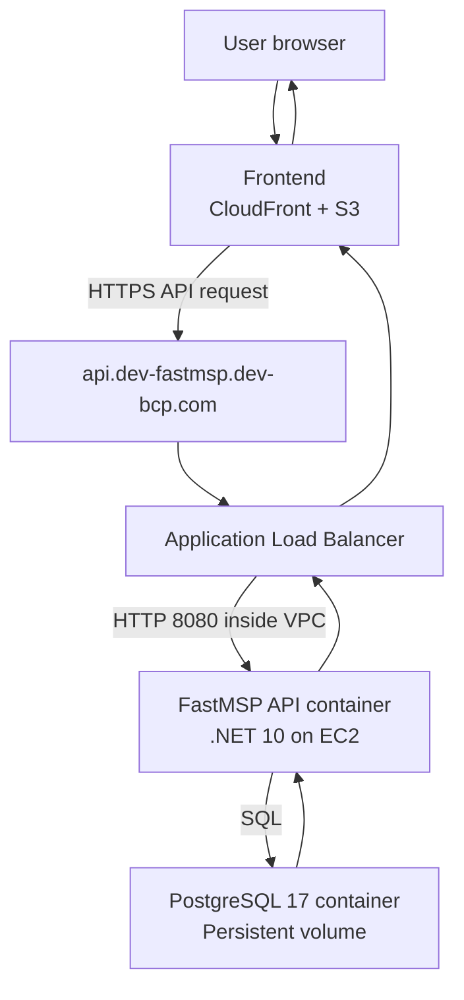
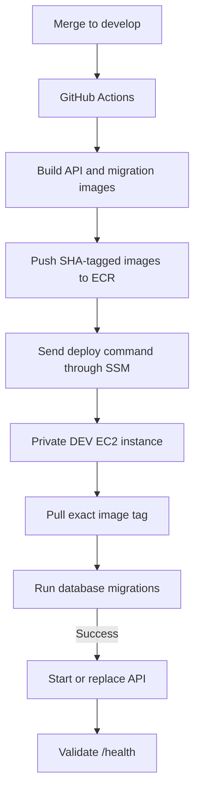

# FastMSP Backend Server Setup and Deployment Workbook

**Environment:** DEV  
**Repository:** `BetterCarPeople/fastmsp-backend`  
**AWS account:** `534725115372`  
**AWS region:** `us-east-1`  
**Prepared:** October 2026  
**Purpose:** Record what we planned, built, deployed, verified, and still need to complete.

> This workbook explains the implementation in operational terms. The files committed to the repository and the live AWS configuration remain the source of truth. Never place real passwords, tokens, or private keys in this document or in Git.

---

## 1. Executive summary

We created a repeatable DEV deployment for a new .NET 10 FastMSP backend. The application is packaged into Docker images, stored in Amazon ECR, and deployed to a private Ubuntu EC2 instance by GitHub Actions. PostgreSQL currently runs as a separate Docker container on the same DEV instance. A one-shot migration container updates the database schema before the API starts.

The public API endpoint is:

```text
https://api.dev-fastmsp.dev-bcp.com
```

The health endpoint is:

```text
https://api.dev-fastmsp.dev-bcp.com/health
```

The DEV deployment was merged into the `develop` branch. A push to `develop` builds new API and migration images, pushes both to ECR with the Git commit SHA as the tag, and sends an AWS Systems Manager command to the private EC2 instance to pull and run that exact version.

### What is running

| Component | Purpose | Runtime behavior |
|---|---|---|
| `postgres` | Stores FastMSP data | Long-running container with persistent Docker volume |
| `migrations` | Applies database schema and DEV seed changes | Runs once during deployment, then exits successfully |
| `api` | Serves the .NET REST/OData backend | Long-running container on port `8080` |
| ALB | Terminates HTTPS and routes the API hostname | Public AWS managed service |
| GitHub Actions | Builds and deploys on changes to `develop` | Runs only when triggered |
| Amazon ECR | Stores deployable Docker images | Persistent image registry |

---

## 2. What problem we were solving

The original task was to provide a new FastMSP backend deployment environment with:

- .NET 10
- PostgreSQL
- Docker-based deployment
- automatic deployment when changes are merged into `develop`
- a stable HTTPS URL for the frontend
- secure access to a private EC2 instance without depending on SSH or a `.pem` file

We also needed to distinguish this new backend from the existing brand-specific FastMSP infrastructure. The older Mitsubishi, GM, FordDirect UAT, and production systems belong to the legacy/current structure and should not be assumed to host the new shared backend.

---

## 3. Architecture

### 3.1 User request and data flow



The frontend and backend are separate deployments:

- The frontend is static content served through CloudFront from S3.
- The frontend JavaScript calls the backend URL over HTTPS.
- The ALB accepts the public HTTPS request and forwards it privately to port `8080` on the backend EC2 instance.
- The API reads or writes data in PostgreSQL and returns a JSON response.

The frontend does **not** connect directly to PostgreSQL.

### 3.2 Build and deployment flow



The backend source code is **not maintained manually on the EC2 server**. The repository contains the source. GitHub Actions creates immutable images, ECR stores them, and EC2 runs them.

### 3.3 Why there are two application images

| Image | Job | Lifetime |
|---|---|---|
| `fastmsp-backend-api` | Runs the web API | Stays running |
| `fastmsp-backend-migrations` | Applies database changes | Exits after success or failure |

This separation prevents a web-server restart from silently modifying the database. It also lets the deployment stop before starting the new API if a migration fails.

---

## 4. Repository assessment

The repository already contained three .NET 10 projects:

| Project | Role |
|---|---|
| `BetterCarPeople.FastMSP.Service` | ASP.NET Core API with controllers, OData, health checks, Entity Framework Core, CORS, and FusionAuth configuration |
| `BetterCarPeople.FastMSP.Database` | FluentMigrator console application containing schema and DEV seed migrations |
| `BetterCarPeople.FastMSP.AppHost` | .NET Aspire orchestration used for local development |

The solution file is:

```text
BetterCarPeople.FastMSP.slnx
```

### Important technical findings

- All three projects target `net10.0`.
- PostgreSQL access uses Npgsql.
- The API health endpoint checks PostgreSQL.
- Database migrations use FluentMigrator, not Entity Framework migrations.
- `--tag=dev` applies schema migrations and DEV sample/seed data.
- `--tag=prod` applies production-safe schema migrations without DEV seed data.
- Aspire can start PostgreSQL, FusionAuth, the API, and the migration project locally.
- Authentication and authorization middleware were still commented out in the API at the time of this work.

---

## 5. Implementation plan we followed

1. Inspect and build the repository locally.
2. Run the existing Aspire application to understand the components.
3. Add production-style multi-stage Dockerfiles for the API and migration runner.
4. Add a local Compose stack for repeatable local testing.
5. Create a new private DEV EC2 instance rather than reuse a legacy brand server.
6. Install and validate Docker on that EC2 instance.
7. Store the PostgreSQL password in AWS Systems Manager Parameter Store.
8. Create separate ECR repositories for the API and migration images.
9. Bootstrap the Compose deployment on EC2 and verify application health.
10. Configure GitHub Actions to authenticate to AWS using OIDC.
11. Deploy automatically from the `develop` branch through SSM.
12. Connect the API to the existing Application Load Balancer.
13. Add Route 53 DNS and the correct ACM certificate.
14. Restrict CORS to the DEV frontend origin.
15. Document hardening, monitoring, scanning, backup, and production work still required.

---

## 6. Local workstation setup and validation

### 6.1 Install and verify .NET 10

The initial command failed with `zsh: command not found: dotnet`, so the .NET 10 SDK was installed. On macOS, the password requested by the installer was the current Mac administrator/login password, not an AWS or GitHub password.

Verification:

```bash
dotnet --list-sdks
```

Observed SDK:

```text
10.0.401 [/usr/local/share/dotnet/sdk]
```

Build the complete solution:

```bash
dotnet restore BetterCarPeople.FastMSP.slnx
dotnet build BetterCarPeople.FastMSP.slnx
```

The build succeeded. Existing StyleCop warnings did not block compilation.

### 6.2 Verify Docker

```bash
docker --version
docker compose version
```

At the time of setup, the workstation reported Docker `29.6.2` and Docker Compose `v5.3.1`.

### 6.3 Run the existing Aspire app locally

```bash
dotnet run --project BetterCarPeople.FastMSP.AppHost
```

Aspire displayed a local dashboard URL and orchestrated the development services. Pressing `Ctrl+C` stopped the local environment. This proved the application model, but Aspire itself was not chosen as the EC2 production deployment mechanism.

---

## 7. Docker packaging

### 7.1 API multi-stage Dockerfile

File: `Dockerfile`

```dockerfile
FROM mcr.microsoft.com/dotnet/sdk:10.0 AS build
WORKDIR /src

COPY BetterCarPeople.FastMSP.Service/BetterCarPeople.FastMSP.Service.csproj BetterCarPeople.FastMSP.Service/
RUN dotnet restore BetterCarPeople.FastMSP.Service/BetterCarPeople.FastMSP.Service.csproj

COPY BetterCarPeople.FastMSP.Service/ BetterCarPeople.FastMSP.Service/
RUN dotnet publish BetterCarPeople.FastMSP.Service/BetterCarPeople.FastMSP.Service.csproj \
    --configuration Release --no-restore --output /app/publish

FROM mcr.microsoft.com/dotnet/aspnet:10.0
WORKDIR /app
COPY --from=build /app/publish .
ENV ASPNETCORE_URLS=http://+:8080
EXPOSE 8080
ENTRYPOINT ["dotnet", "BetterCarPeople.FastMSP.Service.dll"]
```

Why it is multi-stage:

- The first stage uses the large SDK image to restore and compile.
- The final stage contains only the ASP.NET runtime and published output.
- The deployed image is smaller and does not contain the compiler or source tree.

### 7.2 Migration multi-stage Dockerfile

File: `Dockerfile.migrator`

```dockerfile
FROM mcr.microsoft.com/dotnet/sdk:10.0 AS build
WORKDIR /src

COPY BetterCarPeople.FastMSP.Database/BetterCarPeople.FastMSP.Database.csproj BetterCarPeople.FastMSP.Database/
RUN dotnet restore BetterCarPeople.FastMSP.Database/BetterCarPeople.FastMSP.Database.csproj

COPY BetterCarPeople.FastMSP.Database/ BetterCarPeople.FastMSP.Database/
RUN dotnet publish BetterCarPeople.FastMSP.Database/BetterCarPeople.FastMSP.Database.csproj \
    --configuration Release --no-restore --output /app/publish

FROM mcr.microsoft.com/dotnet/runtime:10.0
WORKDIR /app
COPY --from=build /app/publish .
ENTRYPOINT ["dotnet", "BetterCarPeople.FastMSP.Database.dll"]
```

The migration image needs the .NET runtime, but it does not need the ASP.NET web runtime.

### 7.3 Docker build context exclusions

File: `.dockerignore`

```text
**/bin/
**/obj/
.git/
.vs/
.idea/
*.user
.env
```

This avoids copying build output, editor settings, Git history, and secrets into the Docker build context.

---

## 8. Why there are two Compose files

Both files describe the same three services, but they serve different environments.

| File | Used where | Image source |
|---|---|---|
| `compose.yaml` | Developer workstation | Builds from local source using `Dockerfile` and `Dockerfile.migrator` |
| `deploy/compose.yaml` | DEV EC2 instance | Pulls prebuilt, SHA-tagged images from Amazon ECR |

This is deliberate. Developers need quick local builds, while servers should run an artifact already built and tested by CI.

### 8.1 Local Compose design

A readable form of the local file is:

```yaml
services:
  postgres:
    image: postgres:17
    environment:
      POSTGRES_DB: fastmsp
      POSTGRES_USER: fastmsp
      POSTGRES_PASSWORD: ${POSTGRES_PASSWORD:?Set POSTGRES_PASSWORD}
    volumes:
      - postgres-data:/var/lib/postgresql/data
    healthcheck:
      test: ["CMD-SHELL", "pg_isready -U fastmsp -d fastmsp"]
      interval: 5s
      timeout: 5s
      retries: 10

  migrations:
    build:
      context: .
      dockerfile: Dockerfile.migrator
    command: ["--tag=dev"]
    environment:
      ConnectionStrings__Migrations: "Host=postgres;Port=5432;Database=fastmsp;Username=fastmsp;Password=${POSTGRES_PASSWORD}"
    depends_on:
      postgres:
        condition: service_healthy

  api:
    build:
      context: .
      dockerfile: Dockerfile
    environment:
      ASPNETCORE_URLS: "http://+:8080"
      ConnectionStrings__AppConfig: "Host=postgres;Port=5432;Database=fastmsp;Username=fastmsp;Password=${POSTGRES_PASSWORD}"
    ports:
      - "8080:8080"
    depends_on:
      migrations:
        condition: service_completed_successfully

volumes:
  postgres-data:
```

### 8.2 EC2 deployment Compose design

File: `deploy/compose.yaml`

```yaml
services:
  postgres:
    image: postgres:17
    restart: unless-stopped
    environment:
      POSTGRES_DB: fastmsp
      POSTGRES_USER: fastmsp
      POSTGRES_PASSWORD: ${POSTGRES_PASSWORD:?POSTGRES_PASSWORD is required}
    volumes:
      - postgres-data:/var/lib/postgresql/data
    healthcheck:
      test: ["CMD-SHELL", "pg_isready -U fastmsp -d fastmsp"]
      interval: 10s
      timeout: 5s
      retries: 10

  migrations:
    image: 534725115372.dkr.ecr.us-east-1.amazonaws.com/fastmsp-backend-migrations:${IMAGE_TAG:-dev-bootstrap}
    environment:
      ConnectionStrings__Migrations: "Host=postgres;Port=5432;Database=fastmsp;Username=fastmsp;Password=${POSTGRES_PASSWORD}"
    command: ["--tag=dev"]
    depends_on:
      postgres:
        condition: service_healthy
    restart: "no"

  api:
    image: 534725115372.dkr.ecr.us-east-1.amazonaws.com/fastmsp-backend-api:${IMAGE_TAG:-dev-bootstrap}
    restart: unless-stopped
    environment:
      ASPNETCORE_URLS: "http://+:8080"
      ASPNETCORE_ENVIRONMENT: Development
      ConnectionStrings__AppConfig: "Host=postgres;Port=5432;Database=fastmsp;Username=fastmsp;Password=${POSTGRES_PASSWORD}"
    ports:
      - "8080:8080"
    depends_on:
      postgres:
        condition: service_healthy
      migrations:
        condition: service_completed_successfully

volumes:
  postgres-data:
```

The deployed repository version may also contain the explicit DEV CORS variables described later in this workbook.

---

## 9. Database migrations: what they are and why they are necessary

A database contains both data and a structure. The structure includes tables, columns, keys, indexes, and constraints. When backend code expects a new column or table, the database must be updated in a controlled and versioned way.

FastMSP stores those changes as FluentMigrator migrations in:

```text
BetterCarPeople.FastMSP.Database/Migrations/
```

The process is similar to running `php artisan migrate` in Laravel, but this project uses FluentMigrator and PostgreSQL.

### Responsibility split

| Responsibility | Owner |
|---|---|
| Define the required schema change | Backend developer |
| Write and review migration code/SQL | Backend developer and reviewer |
| Run reviewed migration as part of deployment | CI/CD deployment workflow |
| Manage database availability, backups, monitoring, and access | Infrastructure/DevOps |
| Approve production migration timing and risk | Application owner and operations |

You should not manually invent SQL changes requested verbally by a developer. The schema change should be committed, reviewed, tested, and executed by the deployment pipeline.

### Deployment order

1. Start PostgreSQL if it is not already running.
2. Wait until `pg_isready` reports healthy.
3. Run the migration image with `--tag=dev`.
4. FluentMigrator checks the version history and applies only pending migrations.
5. The migration container exits with code `0` on success.
6. Only then does Compose start the new API container.

If migration fails, the API dependency is not satisfied and the new API should not start. This is an intentional safety gate.

### DEV versus PROD

```bash
# DEV: schema plus development seed/sample data
dotnet run --project BetterCarPeople.FastMSP.Database -- --tag=dev

# PROD: production-safe schema only
dotnet run --project BetterCarPeople.FastMSP.Database -- --tag=prod
```

Never run `--tag=dev` in production because it can insert or reset sample data.

---

## 10. Local container validation

### 10.1 Create a local secret without committing it

Generate or obtain a password, then create `.env` with restrictive permissions:

```bash
umask 077
printf 'POSTGRES_PASSWORD=%s\n' 'REPLACE_WITH_A_LOCAL_DEV_SECRET' > .env
chmod 600 .env
```

Confirm Git ignores the file:

```bash
git check-ignore -v .env
```

Do not use `printf ... "$POSTGRES_PASSWORD"` unless the shell variable is already populated. Our first attempt wrote an empty value because the variable was unset, which caused this Compose error:

```text
required variable POSTGRES_PASSWORD is missing a value
```

### 10.2 Start and verify the stack

```bash
docker compose --env-file .env up -d --build
docker compose --env-file .env ps
docker compose --env-file .env logs --tail=100 migrations api
curl --retry 10 --retry-all-errors --retry-delay 2 \
  http://localhost:8080/health
```

Observed successful health response:

```json
{
  "status": "Healthy",
  "checks": [
    {
      "name": "postgres",
      "status": "Healthy"
    }
  ]
}
```

The first immediate request returned `Empty reply from server` because the API was still starting. The retry command handled startup timing and returned healthy.

---

## 11. Existing infrastructure investigation

Before creating new infrastructure, we inspected the systems that looked related to FastMSP.

### 11.1 Legacy Windows FastMSP instance

Instance:

```text
i-018a296836c293495
```

It was Windows Server 2022 and hosted IIS sites:

| IIS site | Binding |
|---|---|
| `FastMSP-Mitsubishi` | HTTP `*:8080` |
| `FastMSP-GM` | HTTP `*:8081` |

These are legacy brand applications, not the new shared .NET backend deployment.

### 11.2 Existing Ubuntu instance

Instance:

```text
i-098d647fb5baa6071
```

Name:

```text
dev-MSP-backend
```

Docker was installed, but `docker ps` showed no running containers. Rather than attach the new deployment to an unclear or abandoned host, we created a new, explicitly named instance.

### 11.3 Existing frontend

The frontend hostname `dev-fastmsp.dev-bcp.com` resolves through CloudFront. The identified distribution used:

| Resource | Value |
|---|---|
| CloudFront distribution ID | `E126I4QJ9P5WRN` |
| CloudFront domain | `d1f375wxwc4ziz.cloudfront.net` |
| S3 origin | `534725115372-dev-fastmsp-rewrite.s3.amazonaws.com` |

That confirmed the public frontend is separate from the backend EC2 instance.

---

## 12. DEV EC2 server creation

### 12.1 Selected design

| Setting | Value |
|---|---|
| Name | `dev-fastmsp-backend` |
| Instance ID | `i-0840f0d7f807233f5` |
| Private IP | `10.32.159.151` |
| OS | Ubuntu Server 26.04 LTS |
| Instance type | `t3.medium` |
| Root volume | 30 GiB gp3, encrypted |
| VPC | `vpc-05a7aebd60f4cfe40` |
| Subnet | `subnet-0a8c525fbf81f0e33` |
| Availability Zone | `us-east-1b` |
| Public IP | None |
| Security group | `sg-0151b41f1cb2a72a6` (`dev-fastmsp-backend-sg`) |
| Administrative access | AWS Systems Manager Session Manager |

We reused the existing VPC and private subnet because they had enough addresses and the required network path. We did not need a `.pem` key because the instance is administered through SSM.

### 12.2 Why a private instance

- The API is exposed through the ALB, not directly from EC2.
- Port `8080` is allowed only from the ALB security group.
- No inbound SSH port is required.
- SSM supplies audited shell and command execution through AWS APIs.

### 12.3 Instance IAM role

The EC2 role/profile was configured for:

- `AmazonSSMManagedInstanceCore`
- `AmazonEC2ContainerRegistryReadOnly`
- narrow read access to the DEV PostgreSQL SecureString parameter

The instance needs read-only ECR access because GitHub Actions pushes images and EC2 only pulls them.

---

## 13. Docker installation on EC2

Connect through SSM:

```bash
aws ssm start-session \
  --region us-east-1 \
  --target i-0840f0d7f807233f5
```

Docker was installed from Docker's official Ubuntu package repository, then enabled:

```bash
sudo systemctl enable --now docker
sudo docker run --rm hello-world
sudo docker compose version
```

Successful output included:

```text
Hello from Docker!
Docker Compose version v5.6.0
```

### Application directory

```bash
sudo mkdir -p /opt/fastmsp
sudo chmod 755 /opt/fastmsp
```

Sensitive files were kept root-readable only:

```bash
sudo chmod 600 /opt/fastmsp/.env
sudo chmod 600 /opt/fastmsp/compose.yaml
```

The initial SSM shell could not `cd /opt/fastmsp` because the directory permissions were too restrictive. Setting the directory to `755` fixed traversal while retaining `600` on the secret-bearing files.

---

## 14. Secrets management

### 14.1 Parameter Store

The DEV PostgreSQL password is stored as an SSM SecureString:

```text
/fastmsp/dev/postgres-password
```

It was created using a generated value, for example:

```bash
aws ssm put-parameter \
  --region us-east-1 \
  --name /fastmsp/dev/postgres-password \
  --description "FastMSP DEV PostgreSQL password" \
  --type SecureString \
  --value "$(openssl rand -hex 32)"
```

The actual value must never appear in Git, command output pasted into tickets, or this workbook.

### 14.2 Runtime secret file

The deployment reads the SecureString on the EC2 instance and writes:

```text
/opt/fastmsp/.env
```

Expected shape:

```text
POSTGRES_PASSWORD=REDACTED
IMAGE_TAG=COMMIT_SHA
```

Validation without displaying the secret:

```bash
sudo awk -F= '
  /^POSTGRES_PASSWORD=./ { found=1 }
  END { exit !found }
' /opt/fastmsp/.env && echo "FastMSP secret configured"
```

### 14.3 Important PostgreSQL password behavior

PostgreSQL initializes the database user password only when the data volume is first created. Changing the Compose environment value later does not automatically change the password inside an existing database. Password rotation must update PostgreSQL itself and then update Parameter Store/runtime configuration in a coordinated operation.

---

## 15. Amazon ECR repositories

Two private repositories were created:

```text
534725115372.dkr.ecr.us-east-1.amazonaws.com/fastmsp-backend-api
534725115372.dkr.ecr.us-east-1.amazonaws.com/fastmsp-backend-migrations
```

### Why ECR is used when EC2 can build Docker images

Although EC2 could technically clone and build source, that would make deployments slow and inconsistent. ECR gives us a controlled artifact flow:

1. GitHub Actions builds once in a clean runner.
2. The build is tagged with the exact Git commit SHA.
3. The tested image is pushed to ECR.
4. EC2 pulls the exact image without needing source code or the .NET SDK.
5. A rollback can pull a previous known image tag.

The `dev-bootstrap` tag was used for the initial manual installation. Normal automated deployments use commit SHA tags.

---

## 16. Initial manual deployment on EC2

After authenticating Docker to ECR, the instance pulled and started the services:

```bash
cd /opt/fastmsp
sudo docker compose config --quiet
sudo docker compose pull
sudo docker compose up -d
sudo docker compose ps
```

The successful result showed:

- PostgreSQL healthy
- migration container exited successfully
- API running and mapped to `0.0.0.0:8080`

Local health validation on the server:

```bash
curl --retry 10 --retry-all-errors --retry-delay 2 \
  http://localhost:8080/health
```

The response was healthy and included a healthy PostgreSQL check.

---

## 17. Git and pull request flow

The deployment work was created from `origin/develop` on:

```text
SYST-340-backend-deployment
```

Main implementation commit:

```text
6675149 SYST-340 add FastMSP DEV deployment
```

Files added or changed:

```text
.dockerignore
.github/workflows/deploy-dev.yml
.gitignore
Dockerfile
Dockerfile.migrator
compose.yaml
deploy/compose.yaml
```

Pull request `#13` was merged into `develop`. The post-merge DEV workflow run succeeded.

### Why it was first pushed to the ticket branch

The feature branch was the review branch, not the permanent deployment target. This is the normal long-term workflow:

1. Create a ticket/feature branch from `develop`.
2. Commit and push the proposed change.
3. Open a pull request into `develop`.
4. Review and merge.
5. The merge creates a push to `develop`.
6. The DEV workflow deploys that merged commit.

This protects `develop` from unreviewed direct changes while still making `develop` the continuous DEV deployment branch.

---

## 18. GitHub Actions and AWS OIDC

### 18.1 Authentication choice

We selected a GitHub-hosted runner using AWS OIDC instead of depending on the existing self-hosted runner. The existing runner was found on instance `i-0dfa920cab4b7a5df`, but the new workflow does not need its long-lived credentials or availability.

OIDC benefits:

- no permanent AWS access key in GitHub secrets
- short-lived AWS credentials per workflow run
- trust can be limited to the repository and `develop` branch
- easier auditing and rotation

Existing OIDC provider:

```text
arn:aws:iam::534725115372:oidc-provider/token.actions.githubusercontent.com
```

Deployment role:

```text
arn:aws:iam::534725115372:role/fastmsp-dev-github-deploy-role
```

### 18.2 Role trust restriction

The role trust requires:

```text
aud = sts.amazonaws.com
sub = repo:BetterCarPeople/fastmsp-backend:ref:refs/heads/develop
```

Therefore a workflow running from an arbitrary branch cannot assume the DEV deploy role.

### 18.3 Deployment permissions

The inline policy `FastMSPDevDeployment` was scoped to:

- push to the two FastMSP ECR repositories
- send and inspect SSM commands for the exact DEV backend instance
- obtain the ECR authorization token

### 18.4 Workflow behavior

File:

```text
.github/workflows/deploy-dev.yml
```

The repository file is authoritative. In simplified form, it performs:

```yaml
name: Deploy FastMSP DEV

on:
  push:
    branches: [develop]

permissions:
  contents: read
  id-token: write

jobs:
  deploy:
    runs-on: ubuntu-latest
    steps:
      - uses: actions/checkout@v4
      - uses: aws-actions/configure-aws-credentials@v4
        with:
          role-to-assume: arn:aws:iam::534725115372:role/fastmsp-dev-github-deploy-role
          aws-region: us-east-1
      - uses: aws-actions/amazon-ecr-login@v2
      - name: Build and push API
        run: docker build, tag with the Git SHA, and push
      - name: Build and push migrator
        run: docker build, tag with the Git SHA, and push
      - name: Deploy using SSM
        run: send the compose update and health-check commands to the DEV instance
```

The workflow records an SSM command ID and checks the command result. A successful GitHub build alone is not enough; the remote Compose deployment and health check also need to succeed.

---

## 19. Load balancer, DNS, TLS, and frontend connectivity

### 19.1 Existing Application Load Balancer

We reused the existing internet-facing ALB:

| Setting | Value |
|---|---|
| Name | `fastmsp-dev` |
| DNS | `fastmsp-dev-438883512.us-east-1.elb.amazonaws.com` |
| ALB security group | `sg-0584fd57ed96e6c20` |
| Other attached SG | `sg-05a1aed7eaae69dd8` |

The existing host-based rules already routed legacy hostnames to different targets and ports.

### 19.2 Why port 8080 does not conflict with legacy Mitsubishi

Ports belong to a specific network address. These are different destinations:

```text
Legacy Windows instance IP :8080
New backend instance IP    :8080
```

The ALB listener rule selects a target group using the request hostname. Each target group then forwards to the configured instance/IP and port. Reusing port `8080` on a different EC2 instance is normal and does not cause a conflict.

### 19.3 New backend target group and listener rule

The new target group was configured for:

| Setting | Value |
|---|---|
| Name | `dev-fastmsp-backend-8080` |
| Protocol/port | HTTP `8080` |
| Health check path | `/health` |
| Success code | `200` |
| Registered target | `i-0840f0d7f807233f5` |

The HTTPS listener received a host-header rule:

```text
Host: api.dev-fastmsp.dev-bcp.com
Action: forward to dev-fastmsp-backend-8080
Priority: 4
```

The backend security group permits TCP `8080` only from the ALB security group. It does not expose port `8080` to the internet.

### 19.4 Route 53

Public hosted zone:

| Setting | Value |
|---|---|
| Domain | `dev-bcp.com` |
| Hosted zone ID | `Z046720828ZNRAROCGM6U` |

Record:

```text
api.dev-fastmsp.dev-bcp.com A (Alias)
  -> dualstack.fastmsp-dev-438883512.us-east-1.elb.amazonaws.com
```

ALB IP addresses can change. Always use the Route 53 alias/ALB hostname rather than configuring a client with the observed ALB IP.

### 19.5 TLS certificate

The ALB's default certificate covered `*.callercx.io`, which does not match the new API hostname. The existing ACM certificate that covers the API is:

```text
arn:aws:acm:us-east-1:534725115372:certificate/5e66a802-8b78-4412-83ad-96dabf333a8c
```

It covers:

```text
*.dev-fastmsp.dev-bcp.com
dev-fastmsp.dev-bcp.com
```

It was attached to the HTTPS listener as an additional certificate. The ALB uses Server Name Indication (SNI) to select the certificate that matches the requested hostname. It did not need to become the default certificate.

### 19.6 TLS troubleshooting and final verification

Initial symptom:

```text
SSL: no alternative certificate subject name matches target host name
```

Cause: the listener was presenting only the `*.callercx.io` certificate, and that certificate had also been attached twice.

We attached the correct `*.dev-fastmsp.dev-bcp.com` certificate and separated DNS testing from ALB testing. A forced resolution test succeeded:

```bash
curl -i \
  --resolve "api.dev-fastmsp.dev-bcp.com:443:ALB_IP" \
  https://api.dev-fastmsp.dev-bcp.com/health
```

Observed result:

```text
HTTP/2 200
server: Kestrel
```

The health JSON reported both the application and PostgreSQL as healthy. DNS subsequently returned the same current addresses as the ALB.

---

## 20. CORS configuration

CORS controls which browser origins may call the API. This is enforced by the backend, so the deployment owner and backend developer should agree on the intended frontend origins.

The repository's base configuration originally allowed all origins, methods, and headers while also allowing credentials. For DEV we prepared deployment-specific overrides:

```yaml
services:
  api:
    environment:
      Cors__Origins__0: "https://dev-fastmsp.dev-bcp.com"
      Cors__Methods__0: "*"
      Cors__Headers__0: "*"
      Cors__AllowCredentials: "true"
```

This change was prepared on branch:

```text
feature/CORS
```

Before marking CORS complete, verify that this branch was committed, reviewed, merged into `develop`, deployed, and tested with an actual browser preflight request.

Example preflight check:

```bash
curl -i -X OPTIONS \
  https://api.dev-fastmsp.dev-bcp.com/health \
  -H 'Origin: https://dev-fastmsp.dev-bcp.com' \
  -H 'Access-Control-Request-Method: GET'
```

Expected response headers should allow exactly the DEV frontend origin when credentials are enabled.

---

## 21. Routine operations runbook

### 21.1 Check public health

```bash
curl -fsS https://api.dev-fastmsp.dev-bcp.com/health
```

### 21.2 Start an SSM session

```bash
aws ssm start-session \
  --region us-east-1 \
  --target i-0840f0d7f807233f5
```

### 21.3 Check containers

```bash
cd /opt/fastmsp
sudo docker compose ps
```

### 21.4 Inspect logs

```bash
cd /opt/fastmsp
sudo docker compose logs --tail=100 api
sudo docker compose logs --tail=100 migrations
sudo docker compose logs --tail=100 postgres
```

Follow API logs temporarily:

```bash
sudo docker compose logs --follow --tail=100 api
```

### 21.5 Validate the deployment file

```bash
cd /opt/fastmsp
sudo docker compose config --quiet
```

### 21.6 Restart without changing versions

```bash
cd /opt/fastmsp
sudo docker compose up -d
sudo docker compose ps
curl --retry 10 --retry-all-errors --retry-delay 2 \
  http://localhost:8080/health
```

### 21.7 Manual pull of the configured tag

Normally GitHub Actions does this. For controlled recovery:

```bash
AWS_REGION=us-east-1
ECR_REGISTRY=534725115372.dkr.ecr.us-east-1.amazonaws.com

aws ecr get-login-password --region "$AWS_REGION" | \
  sudo docker login --username AWS --password-stdin "$ECR_REGISTRY"

cd /opt/fastmsp
sudo docker compose pull
sudo docker compose up -d
```

Do not change `IMAGE_TAG` casually. Record the previous tag before any manual rollback or deployment.

### 21.8 Controlled rollback

1. Identify the previous known-good Git commit SHA from ECR or a successful workflow run.
2. Back up `/opt/fastmsp/.env` metadata without printing the password.
3. Set `IMAGE_TAG` to the previous SHA.
4. Pull and start that image.
5. Verify `/health` and application behavior.
6. Document the rollback in the ticket.

Application rollback does not automatically reverse database migrations. Database changes require an explicit, reviewed compatibility/rollback plan.

---

## 22. Troubleshooting guide

### `dotnet: command not found`

Cause: .NET SDK not installed or not on `PATH`.

Check:

```bash
dotnet --list-sdks
```

Install .NET 10 SDK and open a new shell if needed.

### Compose says `POSTGRES_PASSWORD` is missing

Cause: `.env` is absent or contains an empty value.

Check safely:

```bash
awk -F= '/^POSTGRES_PASSWORD=./ { found=1 } END { exit !found }' .env \
  && echo configured
```

Do not print the value.

### `curl: Empty reply from server`

The container may be running while Kestrel is still starting. Check API logs and use retries:

```bash
docker compose logs --tail=100 api
curl --retry 10 --retry-all-errors --retry-delay 2 \
  http://localhost:8080/health
```

### Cannot `cd /opt/fastmsp`

The directory needs execute/traversal permission:

```bash
sudo chmod 755 /opt/fastmsp
```

Keep `.env` and `compose.yaml` at `600` if owned by root.

### TLS certificate hostname mismatch

Check which certificates are attached to the ALB HTTPS listener and confirm the certificate SAN includes the exact hostname. `*.dev-fastmsp.dev-bcp.com` covers `api.dev-fastmsp.dev-bcp.com`; `*.callercx.io` does not.

### DNS is uncertain but the ALB may be correct

Resolve an ALB address temporarily and test SNI/host routing with `curl --resolve`. Then separately inspect Route 53. Do not keep a fixed ALB IP in configuration.

### Target group is unhealthy

Check, in order:

1. API is listening on EC2 port `8080`.
2. `curl http://localhost:8080/health` succeeds on EC2.
3. Target group health path is `/health` and matcher includes `200`.
4. Backend SG allows TCP `8080` from the ALB SG.
5. Target group uses the correct VPC and registered instance.

### Migration container exits nonzero

```bash
sudo docker compose logs migrations
```

Do not bypass the migration failure by starting the API manually. Confirm the connection string, database health, migration SQL, and migration tag. Escalate code/SQL failures to the backend developer.

### Docker build reports `NETSDK1064` or a package is missing

The first API image attempt reported a missing restored analyzer package. The later isolated restore/publish Docker build succeeded. If it returns:

- verify NuGet connectivity
- rebuild without stale local `bin/obj` content
- ensure `.dockerignore` excludes `bin` and `obj`
- confirm the Dockerfile restores the project before `dotnet publish --no-restore`

### Data Protection warnings

The API warned that Data Protection keys were stored inside the container and unencrypted. This does not affect the health endpoint, but it matters once cookies or other Data Protection features are used. Persist and protect these keys before relying on container-stable authentication state.

### Kerberos/GSSAPI library warning in migration logs

A `libgssapi_krb5.so.2` warning appeared while migrations still completed successfully. Continue monitoring it. If it becomes fatal for the chosen Npgsql/authentication path, add the required runtime package to the migration image rather than installing ad hoc dependencies on EC2.

---

## 23. Security model implemented so far

| Control | Implementation |
|---|---|
| No direct EC2 public access | Instance has no public IP; administration uses SSM |
| No SSH private key dependency | No `.pem` is required for normal operations |
| HTTPS | TLS terminates at ALB using ACM |
| Restricted backend port | EC2 port `8080` allowed only from ALB SG |
| Short-lived CI AWS credentials | GitHub OIDC assumes a restricted IAM role |
| Branch-limited deployment trust | OIDC subject restricted to `develop` |
| Secret storage | PostgreSQL password stored in SSM SecureString |
| Runtime secret permissions | `/opt/fastmsp/.env` mode `600` |
| Secret exclusion | `.env` ignored by Git and Docker build context |
| Artifact traceability | Docker images tagged using Git commit SHA |
| Deployment gate | API waits for successful migrations |

### Security work still recommended

- Add Trivy scanning for container images/filesystems.
- Add CodeQL for C# or Semgrep with an agreed ruleset.
- Add Dependabot for NuGet, Docker base images, and GitHub Actions.
- Pin third-party GitHub Actions to reviewed immutable commit SHAs if required by policy.
- Enable ECR image scanning and lifecycle policies.
- Persist/encrypt ASP.NET Data Protection keys if authentication requires them.
- Confirm FusionAuth configuration and enable authentication/authorization before exposing protected application data.
- Review CORS after the frontend authentication method is finalized.
- Use a managed KMS key if required by organizational secret-management policy.

Security scans should normally run in a pull-request CI workflow. The deployment job should depend on required checks, rather than discovering basic issues only after merge.

---

## 24. Monitoring, backup, and reliability work still required

The application is healthy, but a successful initial deployment is not the end of operating the service.

### Monitoring

- Send Docker/application logs to CloudWatch Logs.
- Alert on ALB target health.
- Alert on repeated HTTP 5xx responses.
- Alert on EC2 CPU, memory, and disk pressure.
- Alert when the `/health` endpoint fails.
- Monitor PostgreSQL volume usage.
- Retain GitHub and SSM deployment outputs for audit.

### Backup

DEV PostgreSQL currently uses a Docker volume on one EC2 instance. The volume persists across container replacement, but it is not the same as a managed backup strategy.

At minimum for DEV:

- define scheduled logical backups or EBS snapshots
- define retention
- store backups outside the instance lifecycle
- perform a restore test
- document recovery time and recovery point expectations

### Availability

The current DEV architecture is a single-host environment. If that EC2 instance or volume fails, both API and database are affected. This is acceptable only if the DEV availability expectation permits it.

---

## 25. Production design recommendation

Production should not be created by simply copying the DEV host and changing its name.

Recommended production design:

- use the separate production AWS account (`451781105151`)
- keep the API container separate from legacy brand-specific instances
- use Amazon RDS for PostgreSQL, encrypted with automated backups and Multi-AZ if required
- deploy from `main` or a release tag, not `develop`
- use a GitHub production Environment with required reviewer approval
- create a separate production OIDC role with production-only trust and permissions
- create separate ECR repositories or carefully controlled cross-account promotion
- store production secrets in the production account
- use `--tag=prod` for migrations
- configure production ALB, DNS, certificate, security groups, monitoring, and alarms
- test backward-compatible database deployment and rollback behavior
- define a maintenance window for risky migrations

Do not run production migrations interactively inside a container as the normal process. The reviewed migration image should run as a controlled pipeline job or one-shot task, with backups and approval in place. Manual execution should be reserved for documented recovery procedures.

---

## 26. Remaining DEV checklist

### Functional completion

- [x] .NET 10 solution builds locally.
- [x] API Docker image builds.
- [x] migration Docker image builds.
- [x] PostgreSQL, migrations, and API run through Compose.
- [x] migrations complete successfully with `--tag=dev`.
- [x] `/health` reports API and PostgreSQL healthy.
- [x] private EC2 instance created and managed by SSM.
- [x] images stored in ECR.
- [x] GitHub OIDC deployment role configured.
- [x] workflow deploys merged `develop` commits.
- [x] ALB target group and host rule route to the new API.
- [x] correct ACM certificate attached.
- [x] Route 53 alias created.
- [x] public HTTPS health check succeeds.
- [ ] Confirm CORS change is merged and deployed.
- [ ] Run browser-based frontend-to-API integration test.
- [ ] Confirm frontend stores the API base URL in environment configuration.
- [ ] Confirm FusionAuth/authentication design and enable it when ready.

### Operational hardening

- [ ] Add Trivy.
- [ ] Add CodeQL or Semgrep.
- [ ] Add Dependabot.
- [ ] Configure ECR lifecycle rules, for example retaining the latest 30 deployment images.
- [ ] Configure CloudWatch logs and alarms.
- [ ] Define and test DEV database backups/restores.
- [ ] Persist Data Protection keys if needed.
- [ ] Convert manually created AWS resources to Terraform/CloudFormation/CDK.
- [ ] Document owner/on-call and incident escalation.

---

## 27. Verification checklist after every DEV deployment

1. GitHub workflow completed successfully on `develop`.
2. Both ECR images exist with the same commit SHA tag.
3. SSM deployment command completed successfully.
4. Migration container exited with code `0`.
5. PostgreSQL container is healthy.
6. API container is running.
7. Local EC2 health endpoint returns `Healthy`.
8. ALB target group reports the target healthy.
9. Public HTTPS `/health` returns HTTP `200`.
10. Frontend preflight and a real API request succeed.
11. Logs contain no new repeated exceptions.
12. Ticket records the deployed SHA and validation result.

Useful commands:

```bash
gh run list \
  --workflow deploy-dev.yml \
  --branch develop \
  --limit 5

curl -i https://api.dev-fastmsp.dev-bcp.com/health
```

---

## 28. Suggested ticket update

> Completed the FastMSP DEV backend deployment foundation. Added multi-stage .NET 10 API and migration Dockerfiles, local and EC2 Compose configurations, PostgreSQL persistence/health checks, ECR repositories, SSM SecureString secret handling, and a GitHub Actions OIDC deployment workflow triggered by merges to `develop`. Provisioned a private Ubuntu EC2 instance managed through SSM, deployed and validated API/PostgreSQL/migrations, and connected the API through the existing ALB using a dedicated target group, host rule, ACM certificate, and Route 53 alias. Public health endpoint is healthy at `https://api.dev-fastmsp.dev-bcp.com/health`. Remaining work: confirm CORS merge, frontend integration, authentication, monitoring/backups, and security scanning.

Time should be logged according to actual time spent. Do not estimate billable time from this workbook alone.

---

## 29. Key resource reference

| Resource | Identifier |
|---|---|
| Repository | `BetterCarPeople/fastmsp-backend` |
| DEV branch | `develop` |
| DEV EC2 | `i-0840f0d7f807233f5` |
| DEV EC2 private IP | `10.32.159.151` |
| Backend security group | `sg-0151b41f1cb2a72a6` |
| VPC | `vpc-05a7aebd60f4cfe40` |
| Private subnet | `subnet-0a8c525fbf81f0e33` |
| API ECR | `fastmsp-backend-api` |
| Migration ECR | `fastmsp-backend-migrations` |
| DEV secret parameter | `/fastmsp/dev/postgres-password` |
| GitHub deploy role | `fastmsp-dev-github-deploy-role` |
| ALB | `fastmsp-dev` |
| ALB security group | `sg-0584fd57ed96e6c20` |
| API hostname | `api.dev-fastmsp.dev-bcp.com` |
| Health URL | `https://api.dev-fastmsp.dev-bcp.com/health` |
| Frontend hostname | `dev-fastmsp.dev-bcp.com` |
| Route 53 zone | `Z046720828ZNRAROCGM6U` |
| ACM certificate | `5e66a802-8b78-4412-83ad-96dabf333a8c` |

---

## 30. Final mental model

There are four different things to keep separate:

1. **GitHub repository:** the editable source code and deployment definition.
2. **ECR:** versioned, deployable packages built from that code.
3. **EC2:** the computer that runs those packages as containers.
4. **PostgreSQL:** the service where application data is stored; migrations version its structure.

The frontend only needs the public API URL. It does not know which EC2 instance or Docker container is behind the ALB, and it never connects directly to the database.

The repeatable lifecycle is:

```text
Developer change
  -> pull request
  -> merge to develop
  -> GitHub Actions build
  -> ECR images
  -> SSM deployment
  -> database migration
  -> API start
  -> health validation
  -> frontend calls API
```

That is the long-term value of the work: future DEV deployments use the same reviewed pipeline instead of repeating the server setup manually.
